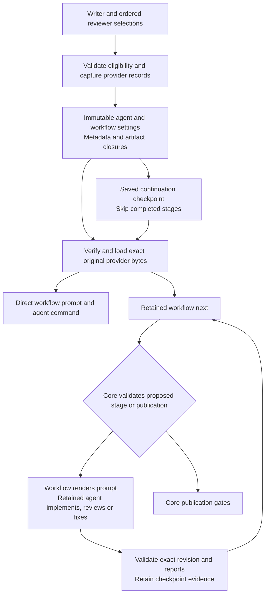

# Agent provider plugins

`helmsman/agent@1` supplies agent command construction, streaming event parsing and model/review metadata. The retained workflow provider owns authored prompts and pure stage sequencing. Core owns process launch, admission, budgets, guarded transitions, review artifacts and publication. Workflow extraction is active; see [workflow authoring](workflow-authoring.md). The shipped providers are `helmsman.agent-codex/codex`, `helmsman.agent-claude/claude-code` and `helmsman.agent-command/command`.

## Public contract

Import `AgentBackendModuleV1`, `AgentProviderV1` and the command/event types from `@helmsman/plugin-sdk`. Agent backends declare only agent capabilities:

```json
{
  "entry": "backend.js",
  "provides": [{ "id": "helmsman/agent", "version": 1, "localId": "worker" }],
  "agents": { "worker": { "access": ["process-description"] } },
  "settings": {},
  "storageVersion": 1
}
```

Activate with `context.registerAgent('worker', provider)`. The context exposes only `pluginId`, `signal`, `settings`, `registerAgent` and `onDispose`; it does not expose storage, usage, publication or process launch services. Backend code remains trusted local JavaScript, not a security sandbox. Use type-only SDK imports when no runtime helper is needed, and keep settings nonsecret: admitted executions retain their values.

The provider implements synchronous `buildCommand(input)` and `parseLine(line)`. Command input includes the retained workflow-rendered prompt (or the original compatibility prompt for a legacy voyage), nullable model and effort, task identity, `stage` (`direct`, `implement`, `review` or `fix`) and `summaryCorrection`. Return `{ cmd, args }` with an executable and argument array; do not spawn processes yourself or bypass core execution and publication guards. Commands permit at most 256 arguments, 256 KiB per argument and 1 MiB total validated JSON. Prompts permit 256 KiB. NUL characters are rejected.

Return `null` for ignored output, or an event with `kind` and `text`. Supported kinds are `phase`, `tool`, `log`, `result`, `usage`, `error` and `review-verdict`. A `result` must include `outcome: 'success' | 'failure' | 'unknown'`; never infer success from a result label alone. `run-complete` is reserved for core and rejected. Optional fields include token usage, nonnegative `costUsd`, `eventId`, model, effort, provider, stage, round and PR number. Lines and events are bounded to 1 MiB. Validate external JSON before accessing nested fields; malformed provider output must not become successful completion.

Metadata declares `version: 1`, a label, nullable default model/effort, low/medium/high review model settings, `reviewSkills`, `reviewDelegation`, `supportsPrePr`, `docker` and `costReporting`. Delegation is `review-agent-skill`, `native-subagents` or `none`. Costs are `delta` or `cumulative`. Docker transport is `openai-responses`, `anthropic-messages` or `null`; unknown providers never inherit Codex credentials. Native commands work with `docker: null`. Set `supportsPrePr: true` only when your command can follow implementation, independent review, correction and fix prompts. Providers without this support cannot enter a gated coding run.

## Build, install and select

The distribution includes independent SDK-only sources in `plugin-sources/agent-codex`, `plugin-sources/agent-claude` and `plugin-sources/agent-command`. Copy a package outside the application and change its reserved manifest ID to your own, such as `example.agent`:

```sh
npm install --save-dev /absolute/path/to/release/sdk typescript
npm run build
node /absolute/path/to/release/server/helmsman/plugins/cli.js pack dist agent.hmp
node /absolute/path/to/release/server/helmsman/plugins/cli.js install agent.hmp
node /absolute/path/to/release/server/helmsman/plugins/cli.js enable example.agent
node /absolute/path/to/release/server/helmsman/plugins/cli.js select-agent example.agent/codex
node /absolute/path/to/release/server/helmsman/plugins/cli.js select-agent-reviewers example.agent/codex,helmsman.agent-claude/claude-code
```

Use the server's plugin directory and restart after changing packages or settings. Reviewer order is preserved, and the complete explicit list for a gated run must include the writer. An old reviewer-count setting does not truncate the list. Explicit missing or disabled selections fail; core never silently substitutes another provider. `select-agent default` and `select-agent-reviewers default` reset their respective selections. Default reviewer order starts with the actual writer and then the default alternatives.

The legacy `PRE_PR_REVIEWER_COUNT` initializes an explicit ordered reviewer list once, preserving an existing explicit list. Afterwards `select-agent-reviewers` controls the whole list; a later `default` reset remains a reset across restart. Legacy `PRE_PR_MAX_ROUNDS` and `PRE_PR_STAGE_TIMEOUT_MINUTES` seed the coding workflow package once. Configure `helmsman.workflow-coding` settings `maxRounds` and `stageTimeoutMinutes` instead of the retired Config controls; explicit package configuration and resets are preserved.

`AGENT_ADAPTER` seeds the initial provider choice once; the generic Config field is retired. Legacy `AGENT_CMD` is never copied into package settings or snapshots because it may contain credentials. Configure the command package's nonsecret `commandTemplate` explicitly. The command provider accepts `{ticket}`, `{repo}` and `{title}` substitutions, and does not support the pre-PR workflow.

## Retained execution and continuation

Admission captures the writer and ordered reviewers, exact package hashes, dependency closure, settings and metadata alongside the selected workflow. The workflow artifact/settings and required skill hashes govern authored prompt rendering and sequencing. Every direct, implementation, review, summary-correction and fix stage uses those captured providers. A restart or continuation does not reread the current provider selection or settings. Disabling a provider stops new admission while retained obligations continue through their exact original artifacts.



Retained activation has the same restricted context as ordinary activation and uses captured settings. Missing or corrupted artifacts, dependency mismatches and changed metadata block execution before an agent runs. Builtin provider aliases load only from the verified original retained application runtime. Module loading and activation are cancellable and bounded; cleanup callbacks run on disposal.
