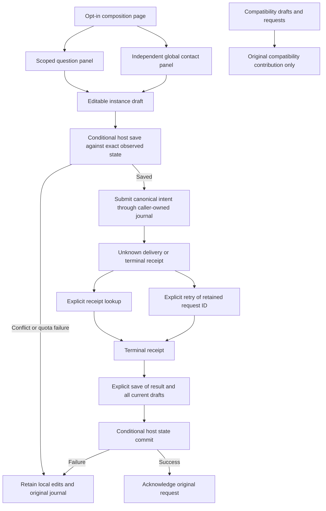

# Authored question and contact panels

The `/clarifications` alias selects the authored question composition through `helmsman/clarifications-page`, with `helmsman.clarifications/page` as its default. Questions and global contacts are independently replaceable panels. A missing or disabled selected page remains unavailable without a compatibility fallback. This cutover does not retire the original compatibility page or its recovery state and does not complete E4.

| Package/contribution | Public boundary | Required services |
| --- | --- | --- |
| `helmsman.clarifications/page` | Composition `helmsman/clarifications-page@1`, alias `/clarifications` and canonical route | composition, clarification-read |
| `helmsman.clarifications/panel` | `helmsman/clarifications-panel@1` | clarification-read, clarification-command |
| `helmsman.suggested-contacts/panel` | `helmsman/suggested-contacts-panel@1`, global settings | suggested-contact-admin |

The page mounts question/contact instances separately through the public composition service. Missing, disabled or failing contacts do not prevent questions from loading or answering. Existing canonical composition layouts remain authoritative when visiting the alias or switching page implementations, including deliberately empty layouts, hidden panels, missing contributions and opaque state. Defaults initialize only absent layouts. The panel packages contain their own UI, state codecs and styles; they do not import the compatibility renderer, host adapters, private route clients or browser storage.

## Build and installation

Distribution source directories are `plugin-sources/clarifications` and `plugin-sources/suggested-contacts`. Each compiles against copied `sdk/` declarations as `@helmsman/plugin-sdk`, with TypeScript installed locally. `node build.mjs` emits package-relative JavaScript and `dist/plugin-package.json`. Runtime SDK imports are unnecessary.

For independently installed copies, choose nonreserved IDs such as `example.questions` and `example.contacts`. Rewrite both descriptors' `manifest.id`, the question page's self-reference from `helmsman.clarifications/panel` to `example.questions/panel`, and its cross-package reference from `helmsman.suggested-contacts/panel` to `example.contacts/panel`. Keep shared composition and panel-contract IDs unchanged. Follow the [package build/pack/install recipe](plugin-packages.md#opt-in-task-presentation-packages), then open `/plugins/example.questions/page`. Select the installed page for the alias with `select helmsman/clarifications-page example.questions/page`; selecting `default` restores the builtin page. The contacts package has an empty pages/entries map and a panel entry.

## Read and command behavior

Questions use scoped cursor pages of 25 and observation-time totals. Required unanswered obligations remain blocking even when unknown provenance, prior attempts or lifecycle state makes them read-only. Run selection emits a typed canonical identity; the host enforces the invoking panel scope. Contact list/create/update always specify `scope: 'global'`, independent of the header galleon. Addresses are arbitrary text, not email-only, and `enabled` remains explicit.

Both panels retain only the current result page and a bounded cursor stack of 128 entries. Page identity, rows and continuation cursors change together only after a successful read. A failed Next, Previous or First page request leaves the prior displayed page and controls intact. Refresh rereads that displayed page; clicking the navigation action again retries the intended page change. First page resets expired or exhausted cursor navigation after its read succeeds. Cursor lifetime is service-owned; reload begins at page one. An update draft retains its original contact revision across list refreshes; rebasing requires discarding that edit and explicitly opening a new one after refresh.

Drafts are separate from reserved command inputs. The host journals use contribution caller identity, so multiple panel instances of the same contribution share unresolved commands while keeping distinct instance drafts. New answer submissions require proven attempt/channel/revision and fresh journal access. Create reserves both IDs in the host journal. Check receipt never redelivers; Retry original uses the optional exact-request `retry` method; the host reads the retained command without reserving new IDs. If another tab acknowledged it, retry sends nothing. Older hosts without this method keep receipt checks available and disable retry. Refresh never resubmits or acknowledges requests.

Terminal results require explicit **Save result and dismiss request**. The panel persists a bounded summary containing request identity, original answer/contact metadata and outcome together with all current drafts, then acknowledges the original journal entry. Server receipts retain full durable outcomes. An answer accepted by the server is not proof of worker consumption. Contact saves send no messages.

## Saved-state boundaries

Both panels require public `context.compareAndSetState(expected, next)` for writes. The exact observed baseline remains unchanged until a successful conditional save or explicit adoption of observed state. Every explicit save verifies the exact baseline even when the local state is unchanged, so a stale clean draft cannot dispatch and a missing prior result cannot authorize acknowledgment. Local saves serialize; newer edits made while a save runs are saved before the operation reports success. A detected external update while local edits are pending preserves those edits and blocks mutation. **Discard local edits and reload saved state** explicitly adopts the host-observed state. No private IndexedDB/local-storage access or unconditional save fallback is used.

Question state allows 64 drafts and 32 terminal summaries; contact state allows one create draft, 64 update drafts and 32 terminal summaries. Each panel caps encoded state at 512 KiB. Unsupported/malformed state remains untouched, and mutation/acknowledgment are disabled. Quota failure leaves unsent text visible and requests pending. Explicit saved-state cleanup rereads the caller journal, rechecks the selected content after that asynchronous read, protects unresolved evidence and conditionally saves against the prior state. It never removes journal entries or automatically evicts evidence.

## Compatibility and remaining migration

The original caller is `helmsman.compat-clarifications/page`. Its answer database is `helmsman.clarification-commands`, its contact database is `helmsman.suggested-contact-commands`, and draft/result keys retain `helmsman.compat-clarifications.drafts.v2:`. These names describe retained host compatibility state, not APIs for authored packages. New panel contributions cannot inspect or adopt those caller-owned requests. Recovery links open `/plugins/helmsman.compat-clarifications/page` and preserve the invoking header scope. The page toolbar keeps the link available for empty or unavailable question layouts. The compatibility contribution retains its original services and can reconcile its own requests after reload or restart.

Alias selection, installation and disablement do not change compatibility records. Oversized and unknown-format saved evidence remains byte-for-byte in its original store, even when the compatibility renderer cannot interpret it. No migration, bulk copy, background resubmission or request-ID transfer occurs. The compatibility draft store can hold 8 MiB, exceeding the 1 MiB host panel-state ceiling, so blind state transfer would also violate storage bounds. The legacy storage format is now owned by the independently buildable recovery package under the original contribution ID. Moving its renderer out of core requires no data migration. Renamed copies receive independent draft namespaces and caller journals; they do not adopt original evidence. Any later storage-format migration still requires demonstrated preservation of unsent edits and unknown deliveries.

Package unit and copied-SDK browser gates cover bounded reads, typed selection, independent services, revision-fenced commands, response loss, explicit receipt recovery, conditional saves, unsupported/quota failures and cancellation. Production source-denied installation tests additionally verify old-caller recovery, missing/disabled contacts, restart, multi-tab state conflicts, alias selection/disablement, retained empty or missing-panel layouts and preservation of oversized or unknown compatibility evidence. Current acceptance evidence belongs in the [implementation ledger](plugin-implementation-progress.md). See [public clarification contracts](clarification-authoring.md), [backend admission](clarification-backend.md) and [panel lifecycle](panel-authoring.md).

_Helmsman · not reported - not reported_

## Question-tab attention

The page's optional `attention(context)` hook reads `services.clarifications.list` for pending, unanswered questions in the header galleon scope. Expired deadlines are excluded even if the backend state has not yet caught up. Unresolved read-only questions still signal operator attention. Reads follow newest-first pagination, bounded to ten pages of 100 questions; the alert does not present an exact count.

`PluginPageAttentionContext` provides the selected contribution ID, header `repo`, cancellation `signal`, and existing public page `services`. Return `{ version: 1, keys }` with at most 1,000 unique, nonempty strings of at most 512 characters, or `null` when attention cannot be observed. Use stable item identities, not changing revisions. The shipped page keys questions by galleon, run and question ID. Hooks are read-only observations, must honor cancellation, and must declare their public read capabilities in the page manifest.

Core polls only the selected questions-slot contribution every five seconds, independently of mounting its page. Custom selected pages can implement the same optional hook; an absent hook, unavailable contribution or failed observation does not fall back to the built-in page. Visiting either its alias or selected canonical page suppresses the alert. Scope, module replacement, disablement and disposal abort stale reads and sound. Attention keys are bounded, validated, and kept only for the current browser session, with a 10,000-identity heard/visited cache.

While another application tab is active, pending questions highlight the Agent Questions tab. Normal motion adds a gentle pulse; reduced motion keeps a static highlight. A short chime sounds once per newly observed pending batch after browser interaction enables audio. Returning to another tab with the same unanswered questions restores the highlight without repeating the chime. Initially pending questions are revalidated before deferred playback; resolving them, visiting Questions or replacing the scope cancels stale deferred sound. Read errors clear the current alert and defer playback until a fresh valid observation. Browser visibility does not itself suppress an already unlocked chime, although background timer/audio throttling remains browser-controlled.
