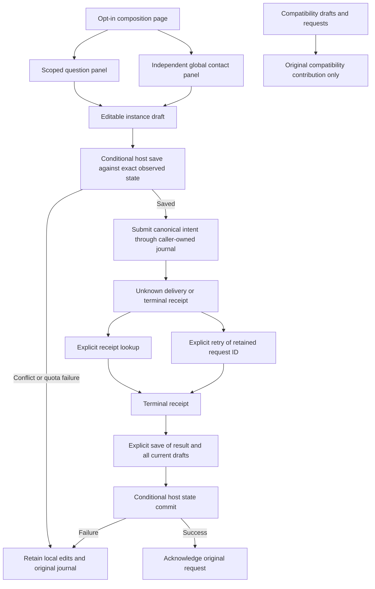

# Authored question and contact panels

This E4 slice adds an opt-in question page and two independently replaceable panels. It does not complete E4 or change the legacy `/clarifications` alias. The compatibility page and its recovery state remain available.

| Package/contribution | Public boundary | Required services |
| --- | --- | --- |
| `helmsman.clarifications/page` | Composition `helmsman/clarifications-page@1`, canonical route only | composition |
| `helmsman.clarifications/panel` | `helmsman/clarifications-panel@1` | clarification-read, clarification-command |
| `helmsman.suggested-contacts/panel` | `helmsman/suggested-contacts-panel@1`, global settings | suggested-contact-admin |

The page mounts question/contact instances separately through the public composition service. Missing, disabled or failing contacts do not prevent questions from loading or answering. Empty saved layouts and selected missing contributions remain intact. The panel packages contain their own UI, state codecs and styles; they do not import the compatibility renderer, host adapters, private route clients or browser storage.

## Build and installation

Distribution source directories are `plugin-sources/clarifications` and `plugin-sources/suggested-contacts`. Each compiles against copied `sdk/` declarations as `@helmsman/plugin-sdk`, with TypeScript installed locally. `node build.mjs` emits package-relative JavaScript and `dist/plugin-package.json`. Runtime SDK imports are unnecessary.

For independently installed copies, choose nonreserved IDs such as `example.questions` and `example.contacts`. Rewrite both descriptors' `manifest.id`, the question page's self-reference from `helmsman.clarifications/panel` to `example.questions/panel`, and its cross-package reference from `helmsman.suggested-contacts/panel` to `example.contacts/panel`. Keep shared composition and panel-contract IDs unchanged. Follow the [package build/pack/install recipe](plugin-packages.md#opt-in-task-presentation-packages), then open `/plugins/example.questions/page`; there is no alias selection or automatic legacy cutover in this slice. The contacts package has an empty pages/entries map and a panel entry.

## Read and command behavior

Questions use scoped cursor pages of 25 and observation-time totals. Required unanswered obligations remain blocking even when unknown provenance, prior attempts or lifecycle state makes them read-only. Run selection emits a typed canonical identity; the host enforces the invoking panel scope. Contact list/create/update always specify `scope: 'global'`, independent of the header galleon. Addresses are arbitrary text, not email-only, and `enabled` remains explicit.

Both panels retain only the current result page and a bounded cursor stack of 128 entries. Page identity, rows and continuation cursors change together only after a successful read. A failed Next, Previous or First page request leaves the prior displayed page and controls intact. Refresh rereads that displayed page; clicking the navigation action again retries the intended page change. First page resets expired or exhausted cursor navigation after its read succeeds. Cursor lifetime is service-owned; reload begins at page one. An update draft retains its original contact revision across list refreshes; rebasing requires discarding that edit and explicitly opening a new one after refresh.

Drafts are separate from reserved command inputs. The host journals use contribution caller identity, so multiple panel instances of the same contribution share unresolved commands while keeping distinct instance drafts. New answer submissions require proven attempt/channel/revision and fresh journal access. Create reserves both IDs in the host journal. Check receipt never redelivers; Retry original uses the optional exact-request `retry` method; the host reads the retained command without reserving new IDs. If another tab acknowledged it, retry sends nothing. Older hosts without this method keep receipt checks available and disable retry. Refresh never resubmits or acknowledges requests.

Terminal results require explicit **Save result and dismiss request**. The panel persists a bounded summary containing request identity, original answer/contact metadata and outcome together with all current drafts, then acknowledges the original journal entry. Server receipts retain full durable outcomes. An answer accepted by the server is not proof of worker consumption. Contact saves send no messages.

## Saved-state boundaries

Both panels require public `context.compareAndSetState(expected, next)` for writes. The exact observed baseline remains unchanged until a successful conditional save or explicit adoption of observed state. Every explicit save verifies the exact baseline even when the local state is unchanged, so a stale clean draft cannot dispatch and a missing prior result cannot authorize acknowledgment. Local saves serialize; newer edits made while a save runs are saved before the operation reports success. A detected external update while local edits are pending preserves those edits and blocks mutation. **Discard local edits and reload saved state** explicitly adopts the host-observed state. No private IndexedDB/local-storage access or unconditional save fallback is used.

Question state allows 64 drafts and 32 terminal summaries; contact state allows one create draft, 64 update drafts and 32 terminal summaries. Each panel caps encoded state at 512 KiB. Unsupported/malformed state remains untouched, and mutation/acknowledgment are disabled. Quota failure leaves unsent text visible and requests pending. Explicit saved-state cleanup rereads the caller journal, rechecks the selected content after that asynchronous read, protects unresolved evidence and conditionally saves against the prior state. It never removes journal entries or automatically evicts evidence.

## Compatibility and remaining migration

The original caller is `helmsman.compat-clarifications/page`. Its answer database is `helmsman.clarification-commands`, its contact database is `helmsman.suggested-contact-commands`, and draft/result keys retain `helmsman.compat-clarifications.drafts.v2:`. These names describe retained host compatibility state, not APIs for authored packages. New panel contributions cannot inspect or adopt those caller-owned requests. Recovery links open the original canonical page and preserve the invoking header scope.

Installing or disabling new packages does not change compatibility records. No migration, bulk copy, background resubmission or request-ID transfer occurs. The compatibility draft store can hold 8 MiB, exceeding the 1 MiB host panel-state ceiling, so blind state transfer would also violate storage bounds. Retiring compatibility requires a separately reviewed migration/recovery contract, demonstrated preservation of unsent edits and unknown deliveries, and explicit alias-cutover acceptance.

Package unit and copied-SDK browser gates cover bounded reads, typed selection, independent services, revision-fenced commands, response loss, explicit receipt recovery, conditional saves, unsupported/quota failures and cancellation. Production source-denied installation tests additionally verify old-caller recovery, missing/disabled contacts, restart and multi-tab state conflicts. Current acceptance evidence belongs in the [implementation ledger](plugin-implementation-progress.md). See [public clarification contracts](clarification-authoring.md), [backend admission](clarification-backend.md) and [panel lifecycle](panel-authoring.md).

_Helmsman · not reported - not reported_
