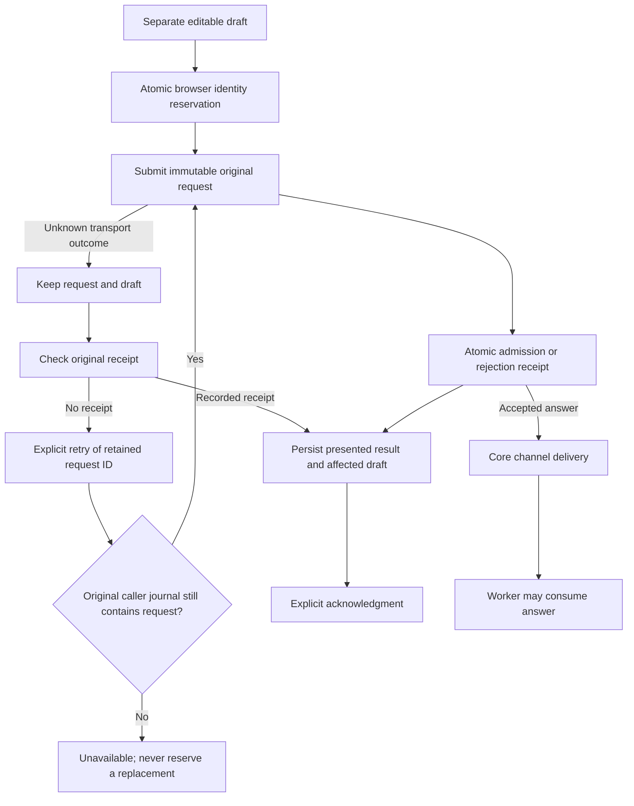

# Clarification and suggested-contact services

Declare `helmsman/clarification-read@1`, `helmsman/clarification-command@1` and, when needed, `helmsman/suggested-contact-admin@1`. Their optional host services are `context.services.clarifications`, `clarificationCommands` and `suggestedContacts`. Import their public types from `@helmsman/plugin-sdk`. These services support the authored question/contact panels and independently buildable clarification recovery package. See the [E4 plan](plugin-phase-e4-implementation.md) and [implementation ledger](plugin-implementation-progress.md).

## Questions and scope

```ts
const questions = context.services?.clarifications;
if (!questions) throw new Error('Clarification reads are unavailable');
const result = await questions.list({
  version: 1, repo: context.state.repo, runId: null,
  states: ['pending'], limit: 25, cursor: null,
}, signal);
```

List and load return `available` with immutable validated DTOs or `unavailable` with a bounded reason. Lifetime, hidden activity, scope changes and caller cancellation reject with an abort error. A package owns its polling lifecycle. Query the invoking scope; a concrete repository scope cannot request an all-repository list. Empty `states` includes every state. Load uses exact repository/run/question identity. Foreign and absent server identities are indistinguishable.

Pages contain at most 100 questions, an opaque continuation, observation time and nullable total. Count and rows share the same scope, filters and database observation. Total describes the complete matching set, not the cursor suffix. State can change between pages; there is no immutable snapshot claim. Cursors bind caller, configured repositories, effective scope and filters and expire when their service instance restarts. An invalid cursor requires an explicit fresh read. Byte bounds can produce a page shorter than the requested limit; follow `nextCursor` rather than inferring completion from length.

Each question includes its revision, prompt, existing ownership/contact fields, state, answer/deadline timestamps, current attempt and proven or unknown provenance. `blocksPublication` remains true for every required unanswered question, including prior attempts and cancelled/timed-out questions. Unknown provenance never becomes the current attempt merely because it appears in a current list. Render `answerability` and its reason; submission rechecks eligibility. The DTO contains no private paths, gate tokens or raw execution snapshots.

## Durable answers and editable drafts

```ts
const commands = context.services?.clarificationCommands;
if (!commands) throw new Error('Clarification commands are unavailable');
if (question.provenance.kind !== 'attempt-channel' || !question.answerability.available) {
  throw new Error('This question cannot currently accept an answer');
}
const result = await commands.submit({
  version: 1, repo: question.repo, runId: question.runId, questionId: question.id,
  expectedAttempt: question.provenance.attempt,
  expectedChannelId: question.provenance.channelId,
  expectedQuestionRevision: question.revision,
  answer: draft,
}, signal);
```

The adapter trims the answer before reservation; nonempty answers are limited to 4000 UTF-16 code units, including newlines. Keep the editable draft separately. The host reserves a durable request identity before network delivery. One unresolved answer exists per contribution/repository/run/question. Identical canonical input reuses its request across tabs and reloads; changed answer text, channel, attempt or revision conflicts until the original terminal result is recorded and acknowledged. Keep changed text as an unsent draft.

Success includes the exact immutable intent, request ID, question ID, post-update revision, canonical answer and acceptance timestamp. It proves durable acceptance, not answers-file delivery or worker consumption. Definitive rejections also have receipts. The database records answer/revision changes and receipts together; receipt failure rolls mutations back. Exact recorded requests replay before current deadline, stop and attempt checks. New admissions check those conditions, the persisted stop intent and immutable channel/snapshot evidence in the same transaction.



Use `pending()` to restore unresolved work, `receipt({ repo, requestId }, signal?)` to reconcile and the optional `retry({ repo, requestId }, signal?)` to retry an exact retained request. Retry reads the caller-owned journal and delivers its immutable original command; it never reserves a request. If another tab has already acknowledged that entry, retry is unavailable and sends nothing. Acknowledgment after the retry reads the command still cannot change its identity: the server replays the original receipt. Older hosts may omit `retry`; disable that action while keeping receipt checks available. Never fall back to `submit` for retry, because a removed reservation would allocate a new identity. A null receipt is an unknown outcome, never permission to invent a new request. Refresh does not imply resubmission. After saving the result and affected draft, call `acknowledge({ repo, requestId }, signal?)`. Only recorded terminal results can be removed. Cancellation during acknowledgment aborts its storage transaction; unknown requests are never silently discarded. Storage failure prevents initial transmission or retains the unresolved request for later recovery.

Each contribution journal permits 256 entries and 8 MiB of encoded pending state. It never evicts unresolved requests to make room. Disabled presentation can leave these requests pending; restoring the same contribution restores its journal. A different contribution has a different caller identity and cannot adopt another caller's requests.

## Global contact metadata

Contacts are a separate explicitly global service. List/load queries and create/update inputs carry `scope: 'global'`; they never carry a repository. Scoped question authorization is unaffected by contact access. A contact outage must not hide questions, discard drafts or prevent otherwise available answers.

Contact DTOs preserve `id`, positive `revision`, `name`, `address`, `enabled` and `createdAt`. Names and addresses are trimmed nonempty text with maxima of 160 and 320 UTF-16 code units. Address can be a Jira account ID or other identifier; it is not restricted to email. Create requires explicit `enabled`. The browser atomically reserves both contact and request UUIDs once. There is one unresolved create per contribution; retry reuses both IDs. Updates target an existing ID and expected revision. Existing legacy IDs remain valid. Saving contacts changes metadata only and never sends a notification.

Contact commands have the same `submit`, optional `retry`, `receipt`, `pending` and explicit `acknowledge` protocol as answers. Retry/receipt/acknowledgment queries carry `{ scope: 'global', requestId }`. Contact create receipts include the host-reserved ID in their immutable intent. Retry delivers that retained command with both its original request and contact IDs. A missing reservation cannot create a new contact; disable retry when the host omits the method. Rejected stale updates require acknowledged results before submitting a refreshed revision.

## Verification and compatibility

The current compatibility question page uses these same public services under `helmsman.compat-clarifications/page`. It is an independently buildable recovery package with package-owned rendering, styles and storage, using only public SDK types and injected services. The contribution ID is deliberately unchanged so original requests remain recoverable. Its optional contact settings are global. Question and contact reads render independently, hidden/disposed pages stop work, and run links preserve the invoking header scope while carrying the target repository separately.

The recovery package requires `context.contributionId`; missing identity fails closed before storage access. The original `helmsman.compat-clarifications/page` retains the exact legacy storage prefix. Renamed installed copies use a separate namespace outside that prefix, matching their own caller journals; they cannot clear original drafts using another caller's pending-request list. No records are copied, rekeyed or automatically replayed.

The recovery page stores editable drafts separately from command journals. Each answer, the global contact draft and each immutable presented request result have separate local-storage keys; a draft write in another tab cannot replace a saved result. Concurrent edits to the same draft use the last successful write. Receipt handling retains draft text, including newer edits, rather than clearing another tab's draft. If a newer local edit has not saved, the page must save that affected draft before recording the result and acknowledging the request. Storage failure leaves recovery controls available. The page displays saved results after reload and never automatically resubmits during refresh. Draft/result storage is bounded to 1024 records and 8 MiB; reaching a bound prevents new saves rather than evicting recovery evidence. The collapsed **Saved drafts and results** section lets the user explicitly discard individual scoped drafts or dismiss saved results; global contact-draft removal is labeled separately. Cleanup requires current successful journal reads and protects records associated with unresolved submissions. It captures the displayed draft before those asynchronous checks and rejects deletion if local edits or persisted content changed. Discarding an already-unsaved edit clears only that local edit and reloads the retained persisted draft; deleting that now-visible saved content requires a second explicit action. The storage helper compares expected content immediately before synchronous removal; local storage does not provide an atomic cross-document compare-and-delete operation. Cleanup never deletes journal entries. This allows a full store to recover without editing raw browser storage.

Codecs reject malformed, oversized, accessor-backed, scope-rebound and identity-rebound data. Browser tests cover concurrent reservation, reload, conflicting drafts, response loss, receipt tampering, pending bounds, unavailable/quota-failed storage and transactional acknowledgment cancellation. Server tests cover exact restart replay, two-connection revision races, stop/deadline/attempt changes, provenance failures and mutation rollback when receipt storage fails.

The host retires or constrains legacy ID-only answer, contact-upsert and unverified-question write endpoints when these services are active. Core ingestion, timeout/cancellation, delivery, final-file draining and publication gates continue when presentation is disabled. [Recovery guidance](recovery.md#clarification-channels-and-unresolved-questions) describes unresolved old obligations and incomplete terminal records.

_Helmsman · not reported - not reported_
