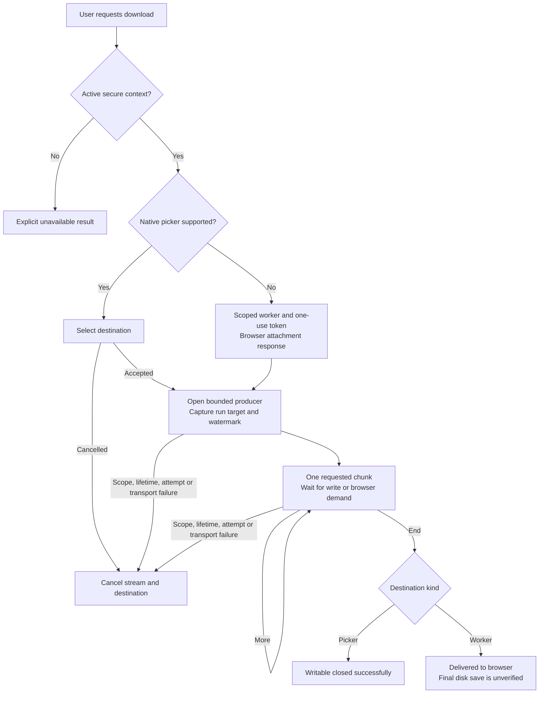

# Streaming downloads

Declare `helmsman/download@1` to use `context.services.downloads`. The host accepts a filename, the exact content type `text/plain; charset=utf-8`, and a lazy byte-stream factory. It does not accept a URL or provide an HTTP proxy. Call `save` directly from the user's click handler so a supported native file picker can open while user activation is available.

```ts
const downloads = context.services?.downloads;
const inspect = context.services?.runInspect;
if (!downloads || !inspect) throw new Error('Run download services are unavailable.');
const result = await downloads.save({
  filename: `run-${target.runId}.log`,
  contentType: 'text/plain; charset=utf-8',
  open: async signal => {
    const exported = await inspect.exportLog({ version: 1, target }, signal);
    if (exported.status !== 'available') throw new Error('Log export is unavailable.');
    return exported.value.stream;
  },
}, operation.signal);
```

The destination is chosen before `open` is called. For a run export, its observation watermark therefore belongs to the time the stream is opened. The producer must provide `Uint8Array` chunks of 1–2,097,152 bytes, respect its abort signal, and cancel underlying work when its reader is cancelled. The host splits coalesced input into writes or messages of at most 65,536 bytes, waiting for each write or worker pull before continuing. It retains at most one bounded source chunk and one outgoing chunk, and never builds a complete Blob or text string. Upstream producers must also bound their own queues and database reads.

The request filename contains 1–200 ASCII letters, digits, spaces, periods, underscores or hyphens, starts with a letter or digit, and cannot end in a period or space. There are no directory paths, header characters or arbitrary MIME types. These checks apply again in the download worker.

## Results and cancellation

| Result | Meaning |
|---|---|
| `saved` | The file picker destination's writable stream closed successfully. |
| `delivered-to-browser` | All bytes reached the browser's download response. This does not prove that the browser finished saving them to disk. |
| `cancelled-stream` | The user, caller, panel scope or plugin lifetime cancelled delivery. A file picker that is already open may stay open; accepting it later does not start the source. |
| `unavailable` | The context is inactive, insecure, or has neither a supported picker nor service worker transport. |
| `failed` | Input, source, destination or download transport failed. No success is inferred from a partial file. |

Terminal delivery results include `bytesWritten`; this measures bytes passed to the destination, not a verified final disk size. Picker cancellation does not silently switch to another destination. Scope changes and plugin disposal abort the current source and destination. An attempt change must cancel the export producer; the run inspection service supplies that fencing. Preview truncation and run-wide log provenance remain separate from export completeness.

The native picker is preferred when available. Its writable stream supplies backpressure and abort semantics. Other supported secure contexts use a service worker registered only under `/plugin-download/`. A same-origin iframe requests a one-use random download token. A `MessageChannel` carries one bounded chunk per requested sequence. Short token expiry, bounded session counts, transport leases, cancellation, and terminal cleanup prevent a lost host from retaining a live producer. The service worker cannot fetch a user-supplied URL.

Actual Playwright downloads have verified identical 28,917,760-byte Unicode output in Chromium, WebKit and Firefox. Scope cancellation stops the source in all three. Chromium and WebKit report the native download failure. Firefox can leave its native download status pending after the worker response errors; the application reports stream cancellation, and does **not** promise that Firefox's download UI is dismissed. Closing the application or losing the service worker can also leave a browser-managed partial download. Browsers control the final destination and native download UI.



Run `npx vitest run src/plugins/download-service.test.ts src/plugins/download-worker.test.ts` for picker sequencing, backpressure, cancellation, late readers, protocol validation, token expiry and failure cleanup. Run `npx playwright test --config playwright.download.config.ts` for actual worker downloads and cancellation in Chromium, WebKit and Firefox. Install the corresponding Playwright browsers before running that gate. The Firefox cancellation scenario explicitly cancels its native download during test cleanup; that automation action is not an application capability. The separate `tests/distribution/run-inspect-foundation.pw.ts` gate installs an independent TypeScript package outside the checkout and checks the copied production server, scoped run APIs, shipped worker and full export-to-download path.
