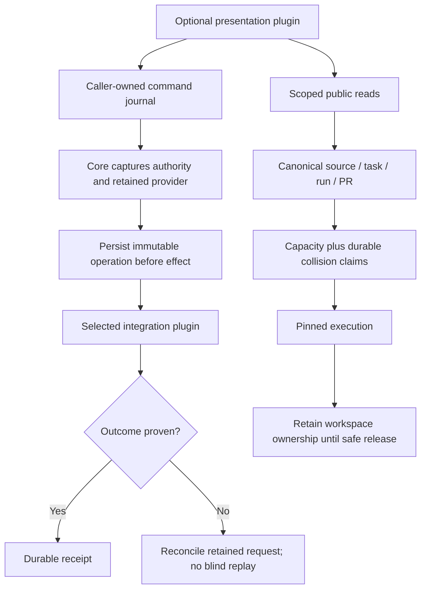

# Remaining feature design and delivery

Status: design approved for implementation by the current user request; the first batch is starting. This document distinguishes planned behavior from shipped behavior. Baseline: `edd5a8a`; OG reference: `4ca712a`. See the [feature evaluation](helmsman-og-feature-evaluation-2026-09-21.md) for commit provenance.

## Decisions

- Keep every optional presentation and integration in independently buildable plugins. Core owns authorization, canonical identity, persistence, admission and recovery.
- First batch: Triage descriptions, Bugs severity badges, Firefox browser provider and authenticated own-PR protection. No new SDK capability is needed for these features.
- Same-galleon parallelism is opt-in; the default remains one active run per galleon. Global limits and unresolved execution obligations always apply.
- Automatic review ownership means the account authenticated by the selected PR connection. Manual configured-author eligibility remains unchanged.
- Feedback is durable in-app submission to an explicitly configured tracker, disabled until configured. No hard-coded destination.
- Assign to me claims only an unassigned task or acknowledges an already-self assignment. Reassigning somebody else's task requires a separate future action.
- Galleon header scope remains the default. Panel overrides never change the header.

## Presentation design

Triage summaries do not carry descriptions. On disclosure, call the existing scoped `TaskReadServiceV1.load` and use `TaskSnapshotV1.requirements.description`; validate the returned selection, canonical ref and task revision against the row, and show changed/unavailable explicitly. Avoid background per-row reads; cancel stale requests on scope/activity changes. Render plain text with preserved newlines, bounded to 32 KiB for display, with an explicit truncation label. Never interpret Jira text as HTML. A keyboard-operable disclosure has a task-specific accessible name and `aria-expanded`; focus survives redraw. Persist expansion by galleon, source instance and canonical WorkRef, independently of group expansion, with bounded retained keys. Before loading, offer Show description; an empty loaded description explicitly says No description available. Scope/source changes cannot expose another task's saved expansion.

Bugs recognizes only unambiguous S0–S5 severity identifiers (standalone or followed by a separator and explanatory text). Display a compact badge with the original value available to assistive technology and on hover. Unknown/custom text stays verbatim; null remains Unknown. Do not infer severity from priority or color alone.

Later presentation batch:

| Feature | Boundary and behavior | Acceptance |
|---|---|---|
| Bugs description disclosure | Add optional bounded `description?: string` to `TaskBugRowV1`, strict parser and Jira projection. Old providers may omit it. Apply the same disclosure behavior as Triage. Preserve explicit metrics/coverage. | Old DTOs/packages still compile; null/malformed/oversized descriptions handled at provider boundary; escaped text, scoped expansion and keyboard flow. |
| Loading wheel | Add an explicitly exported presentation helper/asset to the SDK, consumed through the public package and bundled by each author build. Use accessible status text and reduced-motion styling. | Copied packages contain the asset; reduced motion does not animate; loading never removes unavailable/error announcements; narrow layout. |
| Operator disclosure | Move existing operator note into Config's shared introduction, including loading/unavailable paths. Retain footer Recovery and Pirate controls. | Normal/unavailable Config and shell browser snapshots; no missing controls or duplicate note. |
| First-log readiness | Keep cursor polling. An initial unavailable page remains retryable and later pages render once without relaunch. | Existing reader/service coverage plus a focused delayed-first-page regression if absent. |

## Browser and automatic reviews

Detailed contracts, session state machine and acceptance are in [Firefox and authenticated review design](helmsman-og-design/browser-and-review.md).

Firefox implements existing `helmsman/native-terminal@1` with browser support and explicit unsupported terminal operations. Ship `helmsman.native-firefox/firefox`, selectable independently from the terminal host. Keep current defaults. Only credential-free loopback WebDriver/BiDi endpoints are accepted. No redirects, implicit action replay, foreground-tab switching, or attachment to a replacement session during an operation. A lost trusted-click response remains uncertain. Use disposable Firefox profiles for interoperability verification.

Own-PR observation uses `profile.login` and exact-head `detail.authorLogin` from one captured provider/connection, with authority checks after asynchronous reads. Only known-other authors may automatically dispatch; own blocks and unknown remains queued. Persist bounded evidence without credentials. The claim/currentness check must be synchronous with the final queue mutation. Scope this initial policy to the automatic incoming Slack review path that OG changed; do not change manual reviews or created-PR reviewer requests.

## Durable commands and contextual actions

[Remote actions, feedback and canonical context design](helmsman-og-design/durable-commands.md) specifies additive SDK contracts, affected paths, journals and acceptance. The following decisions refine its illustrative contracts and take precedence:

- Core supplies provider/artifact/credential identity. A provider returns only domain preparation data; never trust provider-returned IDs as authority to select another binding or connection.
- Feedback is tracker-neutral. The public destination uses an opaque destination ID and safe display label/URL; GitHub repo/labels are private provider configuration, not a required GitHub-shaped field on every tracker.
- Source actions require caller, source instance/revision, canonical task/ref and expected task revision. The Jira provider captures `/myself`, status and expected assignee before planning its retained `assign` effect. Different non-null assignees are rejected.
- External APIs do not provide a generic atomic compare-and-set. A last read reduces the Jira assignment race but cannot eliminate changes between GET and PUT; document this provider limit and never claim atomic external assignment.
- Reconciliation proves application of a retained request; absence of a feedback marker alone does not prove non-application. Unknown mutations do not resend automatically.
- Pending commands retain their original destination, source, settings and artifacts through disablement/replacement. New commands require current enabled authority. A credential subject change requires reconciliation/recovery, never retargeting.
- Underway initially adds read-only canonical run/PR navigation. A later Slack action uses the existing communication command journal and exact PR validation. Duplicate ticket names, branch names or PR titles confer no identity.

## Same-galleon parallelism

The [reservation and recovery design](helmsman-og-design/concurrency.md) specifies the migration and cross-cutting implementation. Capacity reservations and collision ownership are separate lifetimes: a resumable checkpoint can release active capacity while retaining its branch/workspace/task protection. Legacy rows lacking a provable footprint remain galleon-exclusive. Do not simply remove `UNIQUE(repo)` or change an in-memory scheduler map.

Preparation must use fetched object IDs/private refs rather than shared `FETCH_HEAD`. Campaign admission, source discovery/admission, branch creation, worktree cleanup, stop/retry and recovery must all enforce the same durable collision policy. Retained schema pins must be compatible before a schema migration; an operator cannot bypass an incompatible retained artifact by enabling parallelism.

## Delivery sequence

| Batch | Deliverable | Dependencies and completion gate |
|---|---|---|
| 1 — Independent ports | Triage disclosure, severity badges; Firefox package; automatic own-PR guard | Three isolated worktrees. Focused regressions, independent review, integrated TypeScript/build/unit gate, affected browser and copied-package/distribution checks. Real Firefox evidence or an explicit remaining interoperability limit. |
| 2 — Presentation and context | Bugs read extension, loading helper, Config note, log readiness; Underway canonical read service and navigation | Additive SDK compatibility and author build, visual and scope tests. No remote writes. |
| 3 — Source action | Public remote-action declaration/service, journal, retained resolver, Jira assign-self, Triage action | Contract proof before provider/UI; duplicate/restart/stale identity and lost-PUT reconciliation tests. |
| 4 — Feedback | Tracker-neutral capability, disabled/configured selection, durable draft and command, GitHub Issues provider | Operation-ledger integration and retained artifact lifecycle; lost-response reconciliation, draft recovery and destination-authority tests. |
| 5 — Parallel execution | Compatible schema rollout, collision ownership, policy/settings, all admission paths, cleanup/recovery | Migrate disposable legacy databases; same-task/branch/PR/workspace conflicts, independent branches, restart and unresolved-worker tests; controlled opt-in rollout. |

Batches 2–4 may use independent worktrees after their shared contract changes land. Batch 5 follows a dedicated architecture review; no default parallelism flip. These batches extend completed rewrite phases A–G rather than reopening their completion status.

## Verification and rollout

Use focused tests during editing and one settled integrated gate. Re-run only checks affected by subsequent fixes. Add regression tests for real behavioral risks, not every cosmetic line. All live-effect testing uses disposable fixture services/profiles; do not send real Slack/Jira/GitHub messages or start user workloads.

For each delivered batch update affected package READMEs, author/operator guides, this status, the implementation ledger and Markdown/HTML flowcharts. Review every commit as a Senior Software Architect, correct material findings, then push the existing feature branch and verify its remote SHA. Mark planned versus implemented features explicitly; mocks alone do not prove real-provider compatibility.

## Review corrections incorporated

Independent design exploration identified campaign exclusion and shared `FETCH_HEAD`, schema-v1 retained pins, checkpoint ownership beyond active capacity, and one-decision-per-galleon source scheduling. These are explicit parallelism requirements. Main-thread review separated provider domain data from core authority, removed GitHub specificity from the future feedback contract, resolved assign-self takeover policy, documented the external Jira compare-and-set limitation, and corrected the Triage transport assumption: summary rows lack descriptions, so disclosure uses the existing on-demand task load service.

_Helmsman · not reported - not reported_
