# Helmsman voyage flow

Open [helmsman-process.html](helmsman-process.html) for the standalone diagrams. They work offline and can be printed or saved as a PDF from a browser.

The flow now includes Moon Units-inspired intake, frozen execution settings, isolated agent stages, Agent Questions, durable evidence and recovery, and Costs & Outcomes. Those services surround the existing exact-revision PR review gate; they do not replace it.

## OG feature extensions

The [remaining-feature design](helmsman-og-feature-design.md) extends completed phases A–G. The first batch adds scoped Triage description reads, accessible severity badges, an independently selected Firefox browser provider and authenticated ownership checks for incoming Slack reviews. Batch 2 adds Bugs descriptions, public loading wheels, the Config operator note and canonical Underway run/PR navigation. Assignment, feedback, Underway Slack commands and opt-in same-galleon parallelism remain planned; the current one-run-per-galleon default is unchanged.

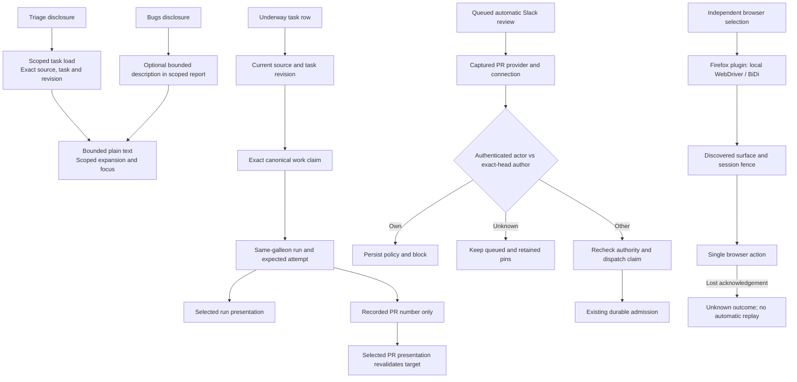

Firefox selection does not change the terminal host or automatically replace the existing browser default. Terminal operations remain explicitly unsupported by Firefox. Operator setup and platform verification are recorded in its [README](../src/plugins/native-firefox/README.md).

## Plugin task presentation and command authority

Costs, Helm, Todos, Triage, Bugs, Source settings and Communication use public plugin services. Task and Communication aliases select registered page implementations; core Config links to the separate Source settings page. The notification header, Communication panels and Slack provider are independently buildable. Scheduling, agents, execution hosts, native terminal/browser providers, workflows and triggers are independently replaceable; Phases A–G are complete, including retirement, SDK stabilization and final acceptance. See the [implementation ledger](plugin-implementation-progress.md).

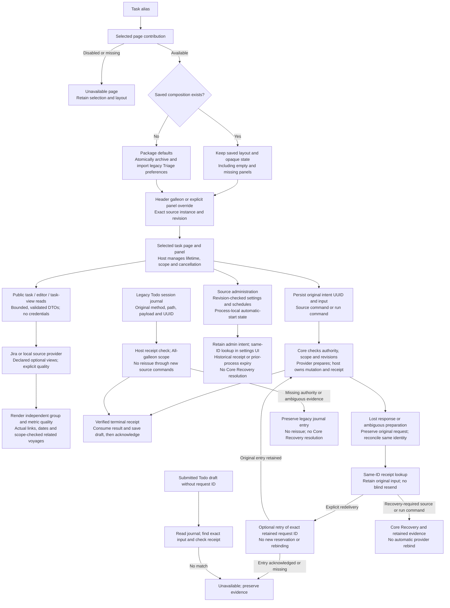

Triage applies provider filters before pagination and preserves independent cursors under a fixed observation window. Its related voyages are enriched from canonical task claims and checked against actual runs in the selected galleon. Editor associations instead come from the provider; core verifies run existence and galleon scope without asserting claim ownership. Bugs labels approximate counts, unknown metrics and capped resolution samples separately. A source or presentation disablement denies new work while retained execution and effect obligations stay pinned. A historical automatic-start receipt never establishes the current process's enabled state. Package code is trusted; DTO and import validation do not provide a security sandbox.

## Admission, Stop and recovery evidence

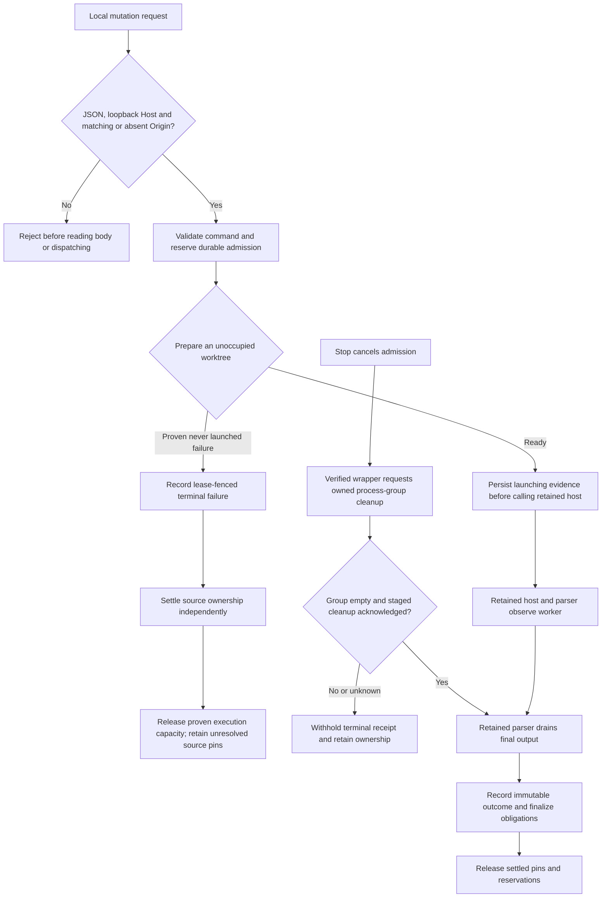

An occupied branch is refused even if its checkout is clean. Retrying never authorizes removal of another checkout. Proven pre-launch failure differs from an uncertain launch: uncertain execution and unresolved legacy pre-launch claims keep their reservations. Local supervision covers ordinary inherited POSIX process groups; deliberately daemonized descendants need separate supervision. Windows local launches fail closed. See [local host details](../src/plugins/host-local/README.md) and [Recovery](recovery.md).

Plugin collection also retains artifacts needed by pending lifecycle projections. Retained external closures validate Node compatibility before importing any provider, and immutable artifacts reuse one process-scoped ESM identity while each activation keeps its own state and disposal lifetime.

## Run inspection and streamed downloads

Authored Runs/history/viewer packages use selected composition slots; Runs uses the shared auxiliary viewer and a public PR panel.

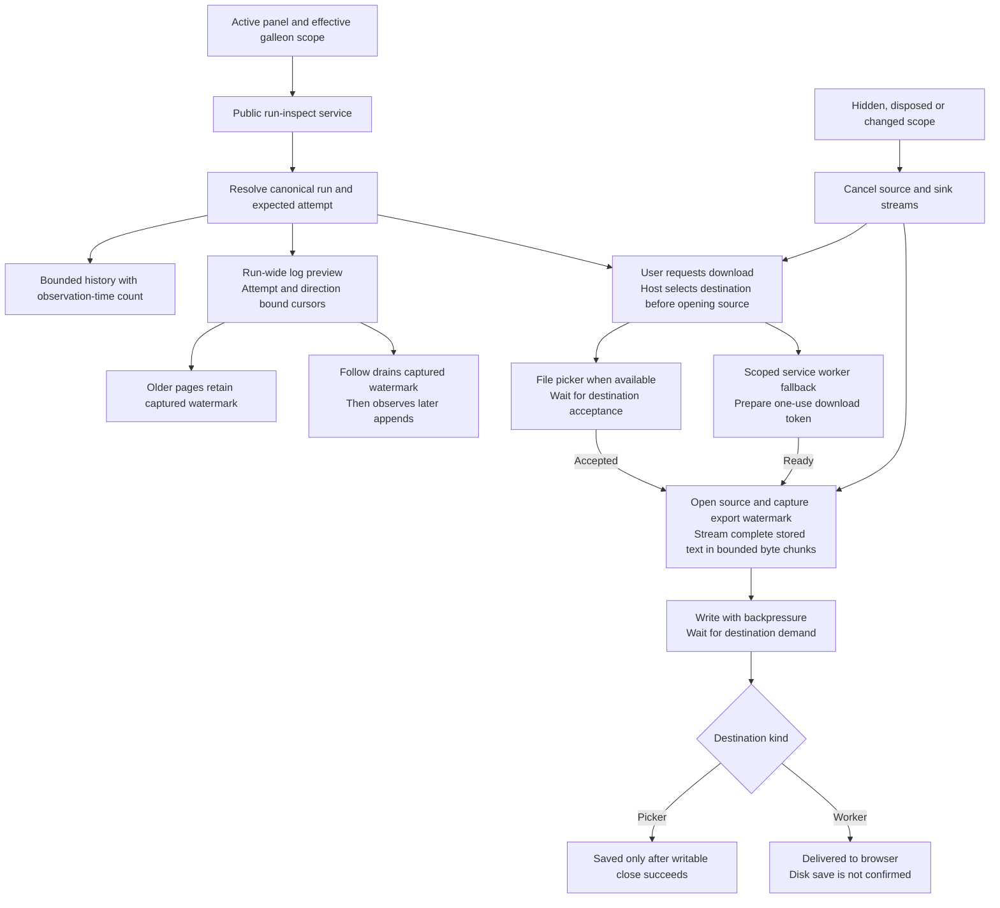

Log events remain run-wide because stored events have no reliable attempt provenance. An expected attempt prevents stale reads and exports; it does not attribute old events to that attempt. History totals describe the current observation within an insertion ceiling, not an immutable status snapshot. The browser fallback avoids a full-log Blob; Firefox stream cancellation does not guarantee an immediate native download failure indication. See [run inspection](run-inspect-authoring.md), [downloads](download-authoring.md) and [clarification recovery](recovery.md#clarification-channels-and-unresolved-questions) for the current contracts.

## Presentation and durable answers

Runs composes the authored history panel and public PR panel; the shared viewer retains selected runs. The PR alias uses an authored composition and the same shared viewer. Clarification recovery is an independently buildable package under its original caller.

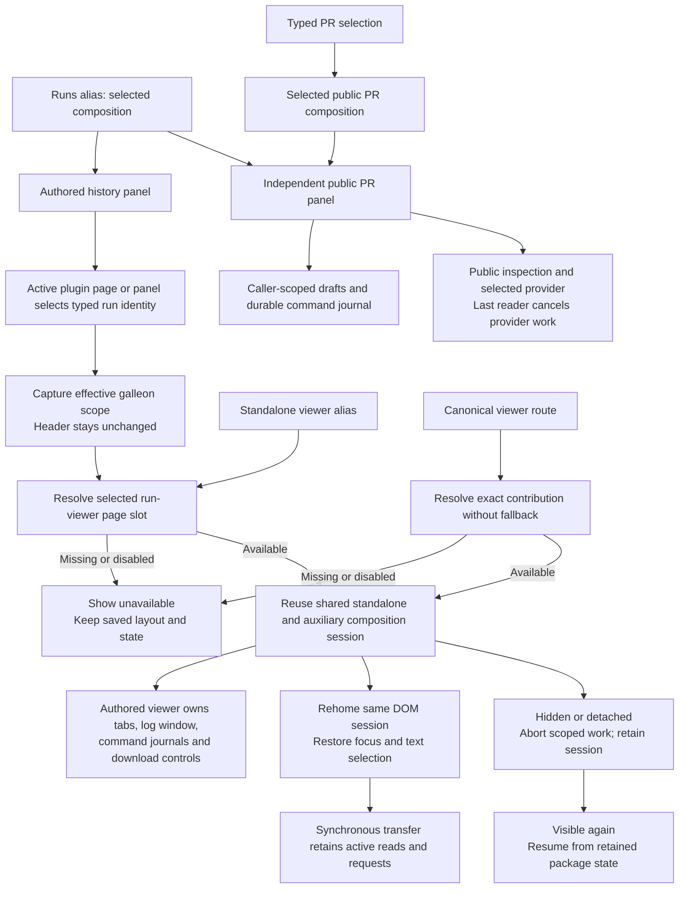

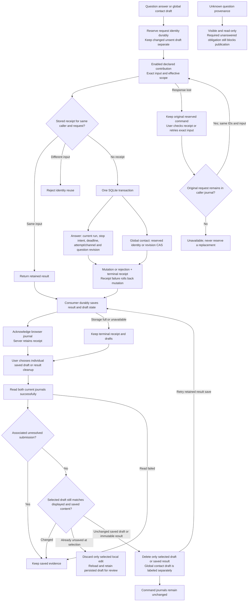

Saved browser drafts and results remain until explicit cleanup. Fresh successful journal reads protect records associated with unresolved submissions; a read failure prevents deletion. Cleanup checks the displayed and saved draft again after the journal read and rejects changed content. Discarding an already-unsaved local edit retains and reloads persisted text for review; deleting that text requires a separate action. Scoped answer drafts, saved results and the explicitly global contact draft have separate removal actions, and none deletes journal entries. Compatibility local storage does not provide an atomic transaction across tabs for the final comparison and deletion.

Answer acceptance does not prove worker consumption. Contacts are global metadata; saving them sends no messages. Disabled contributions retain browser journals and reconcile after reenablement. Legacy HTTP ingestion, ID-only answers and unversioned contact writes return 410 even when the replacement services are unavailable. Trusted worker ingestion still requires its retained attempt channel. See [backend contracts](clarification-backend.md) and [author lifecycle](panel-authoring.md).

## Clarification alias and PR inspection

The clarification alias selects an authored composition; retained compatibility evidence stays under its original identity. PR presentation, inspection and durable review commands use public contracts and selected backend providers. Owned open PRs can route to the authored Communication composition without changing header scope.

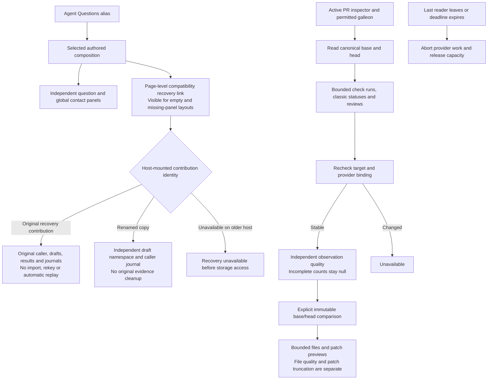

A complete file enumeration never claims complete patches. The public PR package stores drafts and results under its mounted contribution identity. Its command journal reserves exact requests before transport; durable operations retain provider bindings across uncertainty and restart. Disabling the selected PR contribution makes the alias unavailable without restoring a legacy page. See [PR inspection](pull-request-inspect-authoring.md) and [authored clarification recovery](authored-clarifications.md).

## PR review publication

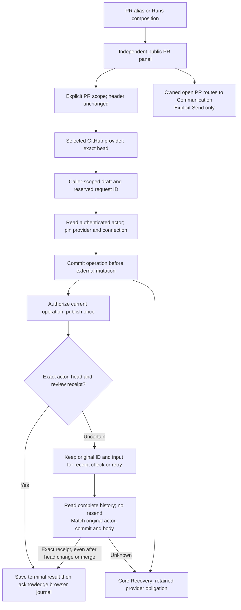

See [PR authoring](pull-request-authoring.md) for public commands and replacement selection.

## Selected PR source for new work

Manual reviews, reruns, communication preparation and outcome refresh use the selected public PR provider. Missing or changed source authority blocks new work. Historical retries and durable publication/send obligations retain their original bindings.

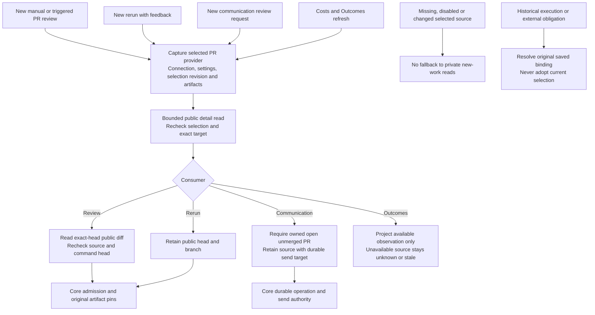

Retired dashboard, task-list and private PR routes return 410 even when a replacement is absent. Authored clients use SDK services with scope, cancellation and caller identity. Core Recovery, historical clarification reads, the read-only Slack diagnostic and exact legacy Todo request recovery remain available. See [route retirement and retained recovery](plugin-legacy-retirement.md).

## Communication notifications and review requests

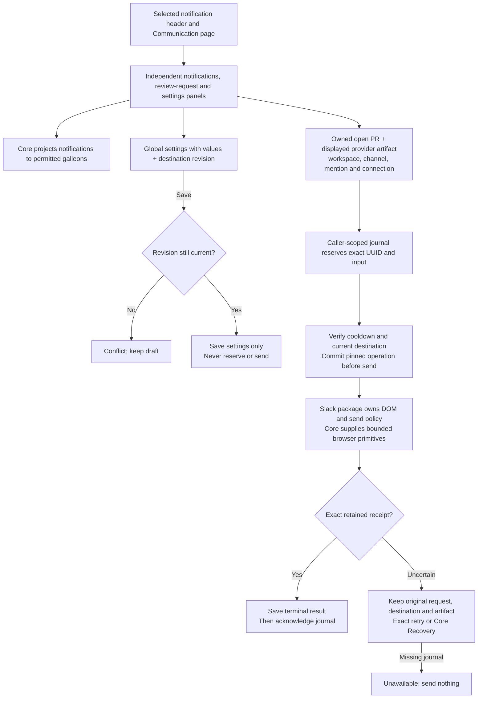

The cooldown covers callers even when a UUID is reused. Disablement blocks new admission but retains pinned public and legacy operation resolvers. An uncertain send cannot be proved by matching the same or another PR URL in Slack; only its exact retained receipt or an explicit Core Recovery resolution can settle it. Browser primitives come from the separately selected native provider; core guards the session and retains the original transport, while the Slack package owns DOM and policy. See [Communication authoring](communication-authoring.md).

## Terminal presentation and durable controls

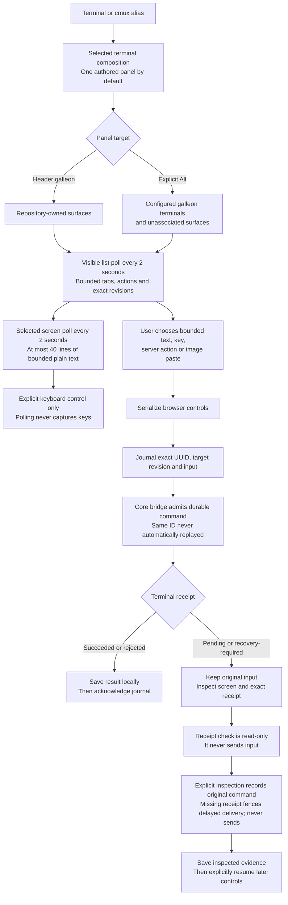

Hidden, replaced, scope-changed and disposed panels abort polling. A target includes its observed bridge/session and surface revision; stale, ambiguous or foreign targets are unavailable rather than rebound. Titles never establish repository ownership. The public service has no terminal-input retry API: inspection acknowledgment never resends retained input or confirms delivery. Missing or unreadable browser evidence prevents controls and never creates a replacement request. The service uses independently replaceable cmux, WezTerm or authored native providers. Tests use a mock fixture and do not touch a native terminal. See [Terminal authoring](terminal-authoring.md).

## Campaign presentation and atomic commands

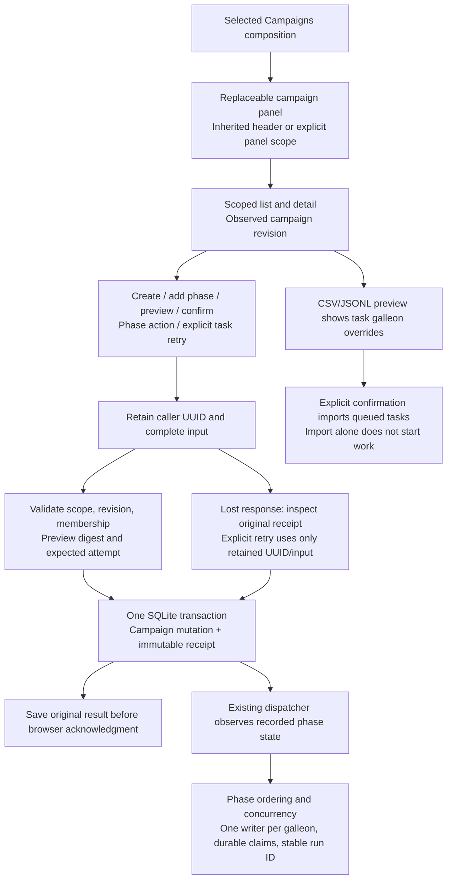

A receipt confirms campaign state, not worker launch or termination. Missing or disabled selected plugins preserve layouts and command evidence. Start, pause, resume, finish and stop keep existing coordination gates; finish/stop retain explicit confirmation. The selected campaign policy owns candidate ordering; core retains durable claims and execution gates. Trigger extraction is reviewed and pushed through `12a62c9`; Phases A–G and their final acceptance gates are complete. See [Campaign authoring](campaigns-authoring.md).

## Local Git confirmation and recovery

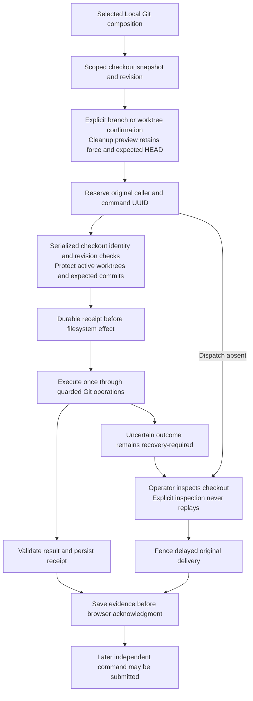

The header galleon remains unchanged by panel overrides. Reads and preview never delete; force and deletion remain explicit decisions. A crash between Git and receipt storage does not prove success or authorize replay. Disabling presentation retains command evidence and host protections. See [Local Git authoring](local-git-authoring.md).

## Replaceable automatic scheduling

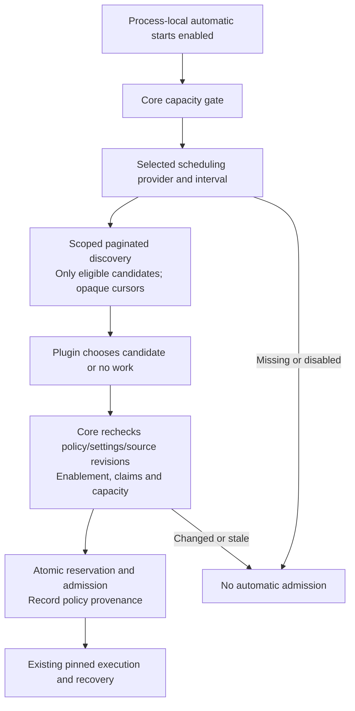

The shipped policy rotates sources; alternatives can choose different ordering and priorities. Restart preserves policy settings and source rotation but resets automatic starts to disabled. Scheduling ends at admission; later disablement does not alter existing execution bindings. See [scheduling authoring](scheduling-authoring.md).

## Agent-provider selection and execution

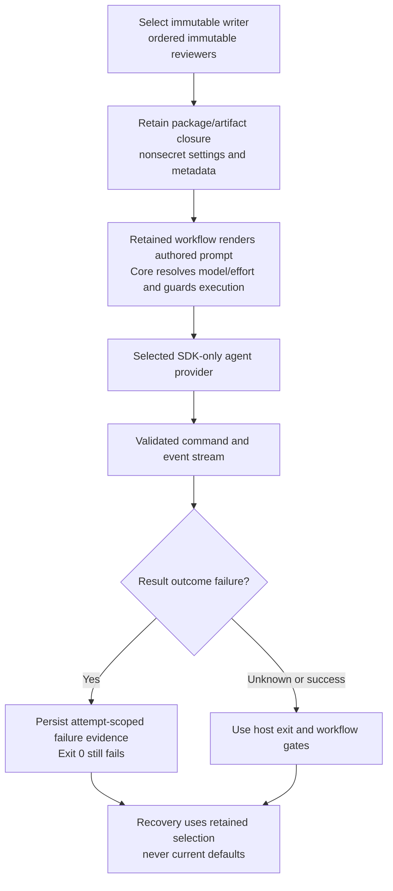

Codex metadata declares its review-agent skill and delta costs; Claude Code declares native subagents and cumulative costs; command declares no pre-PR support and uses a namespaced template setting. Configure packages, then use `select-agent` and `select-agent-reviewers`. The legacy adapter seeds the initial provider selection once. Legacy command text stays available for old-run recovery but is never copied into plugin settings; configure a nonsecret commandTemplate explicitly. Empty command configuration never falls back to Codex. Agent, execution-host and native terminal extraction have passed acceptance; workflow extraction is accepted and pushed through eb8ad1a; trigger extraction is reviewed and pushed through `12a62c9`.

## Workflow selection, guarded stages and continuation

Workflow extraction has passed installed acceptance and independent review and is pushed through `eb8ad1a`. Prompt templates and pure sequencing policy belong to `helmsman/workflow@1`. Core retains admission, exact revision/reviewer checks, stage execution, checkpoints and publication authority.

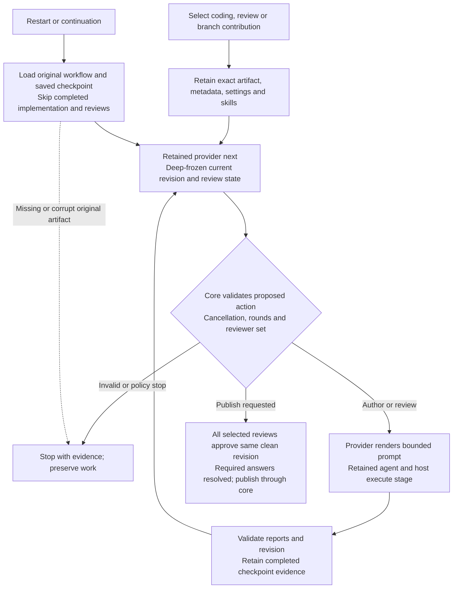

Use `select-workflow <coding|review|branch> <plugin/id>`; `default` or `null` restores that mode's shipped default. Coding is staged; review and branch are direct. Direct execution uses the retained provider's prompt without the staged policy loop. Changed settings or selections affect new admission only; unavailable explicit selections never fall back.

The old reviewer count seeds the explicit ordered agent reviewer list once; `select-agent-reviewers` controls it afterwards. Old rounds and timeout seed `helmsman.workflow-coding` settings `maxRounds` and `stageTimeoutMinutes` once. Explicit settings/lists and later resets survive restart. Legacy voyages without a workflow binding retain their original compatibility path. See [workflow authoring](workflow-authoring.md).

## Execution-host selection and recovery

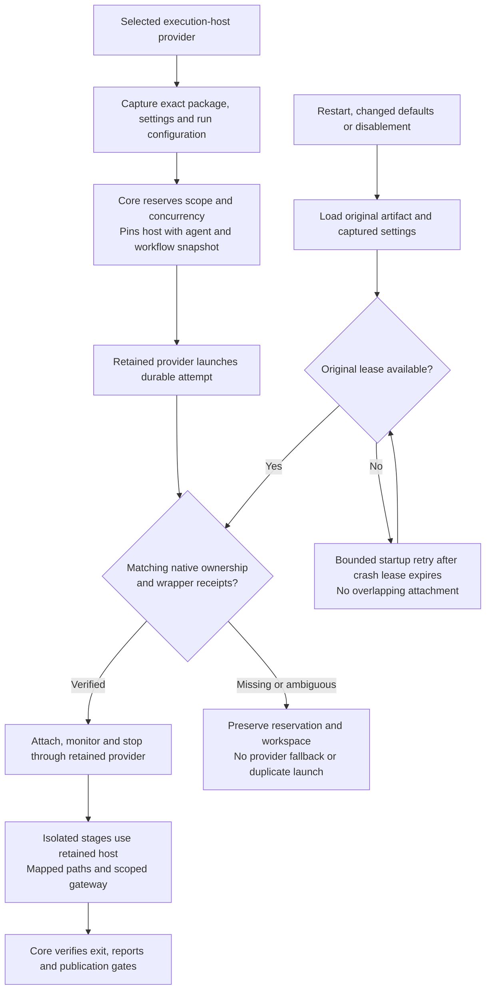

`select-execution-host` selects the local detached/cmux/WezTerm package or Docker package, and accepts independently authored replacements. `prepareRun` captures nonsecret configuration; Docker resolves its image digest there. The browser SDK remains Node-free; backend packages can bundle receipt helpers from `@helmsman/plugin-sdk/node`. New isolated selections require restart for the scoped gateway listener. Disabled providers cannot admit work; existing obligations retain their original host. Graceful shutdown releases only this instance’s leases; startup retries unresolved attachment while crash leases expire. See [execution host authoring](execution-host-authoring.md).

## Native terminal and browser providers

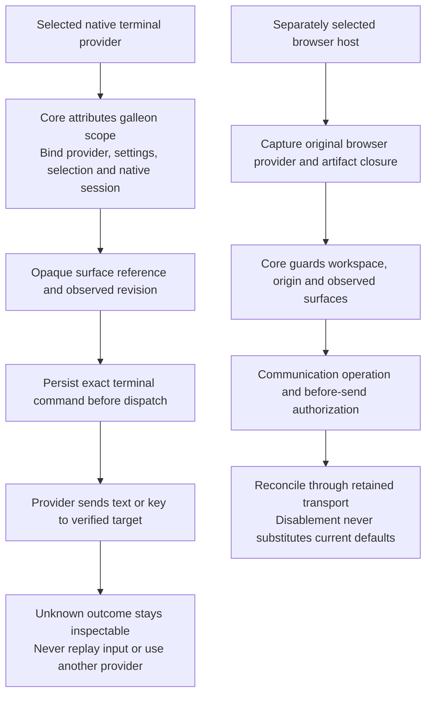

cmux supplies terminal and browser primitives; WezTerm supplies terminal I/O. Independent selections preserve WezTerm terminals alongside cmux-backed Slack. Replacing a native provider invalidates old terminal targets while receipts remain readable. Legacy `/api/cmux/*` endpoints return 410. See [native terminal authoring](native-terminal-authoring.md).

## Header identity and installed-page discovery

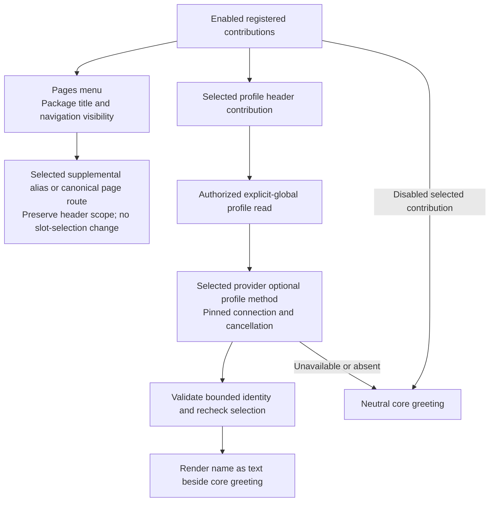

Static shipped tabs remain shell navigation defaults. Auxiliary pages can opt out of menu discovery without losing their canonical routes. Disabling an installed page removes its menu entry while retaining its saved slot binding and unavailable-page state. Optional identity reads never block core navigation. See [profile authoring](profile-authoring.md) and [page registration](plugin-page-registry.md).

## Global integration settings

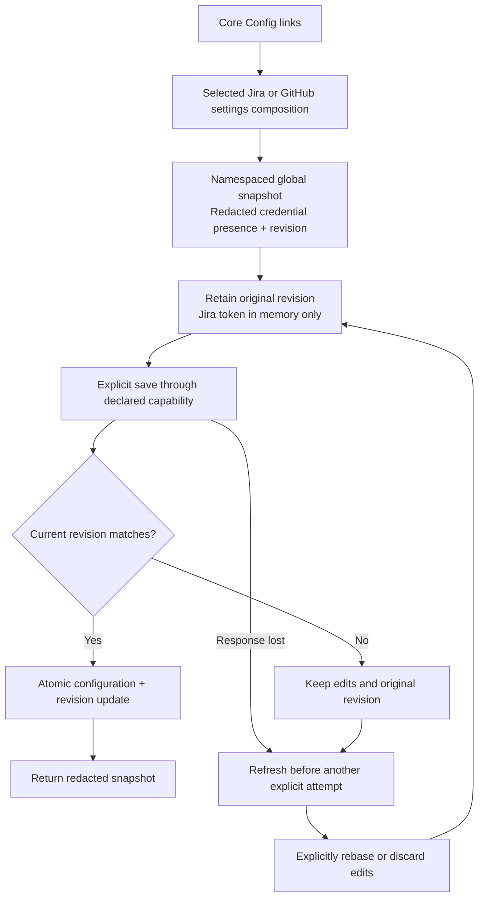

These forms are global and leave the header galleon unchanged. Jira token rotation neither provisions nor enables a source; live project, query and source enablement remain in Source settings. Generic Config rejects migrated integration writes and never echoes submitted values. GitHub watch status is read-only; enablement and interval belong to the selected review trigger settings. Legacy watch flags seed once. See [integration settings authoring](integration-settings-authoring.md).

## Conditional panel-state saves

Authored question/contact panels use conditional panel-state saves. This behavior passed independent package and production acceptance and is pushed as 773cce4:

```mermaid
flowchart TD
    Edit[Draft or terminal command result<br/>Retain exact observed saved-state baseline] --> Capture[Copy bounded expected and next state]
    Capture --> Read[Read current composition]
    Read --> Compare{Caller-owned state matches baseline?}
    Compare -->|No| Conflict[Keep stored state and local edits<br/>Refresh observed state; explicit reconciliation]
    Compare -->|Yes| Commit[Atomic layout revision check and save]
    Commit -->|Concurrent write| Conflict
    Commit -->|Saved| Result[Consumer retains durable result and draft]
    Result --> Ack[Explicit acknowledgment of original journal request]
    Missing[Host lacks optional compareAndSetState] --> Preserve[Disable writes and acknowledgment<br/>Retain original requests]
```

## Trigger selection, capture and guarded dispatch

Trigger extraction is reviewed and pushed through `12a62c9`. The roles `campaign`, `slack-review`, `github-review` and `github-webhook` have independent selections. `default` restores a shipped role; `disabled` or `null` disables it. Polling intervals come from selected trigger metadata.

```mermaid
flowchart TD
    Select[Selected trigger + immutable settings] --> Input{Trigger kind}
    Input -->|Campaign| Candidates[Bounded eligible candidate handles<br/>Campaign concurrency and galleon exclusion]
    Input -->|Review| Reads[Selected communication / browser / PR providers<br/>Capture source revisions and observed event / target handles]
    Input -->|Webhook| Auth[Core credential + raw-body HMAC<br/>Authenticate before duplicate lookup]
    Candidates --> Policy[Bounded plugin choice, scan or parse]
    Reads --> Policy
    Auth --> Policy
    Policy --> Fence{Selection, settings, source and handles current?}
    Fence -->|No or disabled| Block[Discard stale result<br/>No cursor advance or new admission]
    Fence -->|Yes| Store[Existing claim / enqueue transaction<br/>Normalized proposal + provenance + dependency pins<br/>Stable event dedupe and complete-scan cursor]
    Store --> Guard{Original proposal, source, exact head,<br/>current requested-review membership,<br/>workflow, capacity and existing-run checks}
    Guard -->|Allowed| Admit[Guarded admission with original run ID<br/>Verified dependency-pin handoff]
    Guard -->|Blocked| Retain[Keep original queued identity and evidence]
    Admit --> Reconcile[Existing-run receipts and reconciliation<br/>Continue after policy disablement]
    Legacy[Legacy rows without trigger provenance] --> Original[Preserve original payload and run identity<br/>Explicit legacy reconciliation path]
```

All four coordinators require a selected trigger for new intake; no pre-plugin discovery, ordering or webhook parser fallback remains. Campaign capture occurs at claim, not import; an unclaimed imported intent may receive its first policy decision after cutover. Already claimed legacy tasks reconcile the original run without current-policy recapture, including after claim expiry. Saved normalized legacy review/webhook rows keep their original IDs and payloads; disabled triggers still reconcile receipts but do not admit queued work. Watch proposals and complete-scan cursor updates are atomic. Partial or stale scans never advance the cursor. Dedupe keys exclude policy versions, settings and selections; accepted proposals never run through replacement policy. Authenticated ignored webhook events also retain their digest, so later routes cannot reinterpret duplicates.

Campaign candidates share the atomic claim's concurrency and galleon checks; rejected claims are skipped for the rest of the poll. Requested reviews dispatch only after positive source-list membership. Complete source lists retire removed requests independently of policy filtering; partial or failed scans retain unobserved queued work without launching it.

Legacy watch flags and webhook routes seed settings once. Slack/GitHub watch forms expose read-only status and direct operators to the selected trigger plugin. `HELMSMAN_WEBHOOK_SECRET` seeds a core slot once; rotate or clear through `PUT /api/webhooks/github/credential` with `{secret:string}`. Empty clears intake credentials; secrets never enter plugin settings. See [trigger authoring](trigger-authoring.md) and [webhook setup](webhooks.md).

## Intake and execution preparation

```mermaid
flowchart TD
    Manual[Operator selects a galleon<br/>Jira ticket, custom task, local todo or existing PR] --> Prepare[Task source or selected PR provider<br/>Capture exact source, target and head]
    Prepare --> Dispatch
    Campaign[Campaign: create phases<br/>CSV/JSONL preview → confirm → start phase<br/>Selected trigger chooses eligible candidate] --> Dispatch
    Webhook[GitHub webhook, when configured<br/>Core raw-body HMAC + selected parser mapping<br/>Durable normalized proposal and delivery deduplication] --> Dispatch
    Dispatch[Check scope and capacity<br/>One active writer per galleon<br/>Automated dispatch uses durable claims] --> Snapshot[Retain selected workflow artifact, metadata and settings<br/>Verify required skills and provision private copies<br/>Retry/resume must match the original snapshot]
    Snapshot --> Host{Pinned execution-host provider}
    Host --> Local[Retained local host package<br/>Detached, cmux, WezTerm or authored provider]
    Host --> Docker[Retained isolated host package<br/>Pinned image; private workspace and runtime<br/>Run-scoped gateway; host keeps upstream credentials]
    Local --> Workflow{Selected workflow metadata}
    Docker --> Workflow
    Workflow -->|Coding: staged| Coding[Pure provider policy and guarded stages<br/>Exact-revision review loop below]
    Workflow -->|Review: direct| Review[Pin PR head and render retained review prompt<br/>Host verifies result and required answers before posting]
    Workflow -->|Branch: direct| Branch[Retained branch-feedback prompt<br/>Existing PR and source authorization unchanged]
    Snapshot -.->|Missing skills / drift / unavailable host| Block[Fail preflight; no unisolated fallback]
```

Manual launches inherit the header galleon unless a panel explicitly selects another. Campaign record overrides are shown in the import preview; webhook targets and workflows come only from configured mappings. Campaign phases control dispatch and concurrency; durable claims and stable run IDs allow reconciliation after uncertain launches.

In Docker mode the host supervises, verifies artifacts, and publishes; only writer/reviewer stages enter containers. Agent containers reach approved provider operations and restricted GitHub reads through a capability-scoped gateway. They receive no long-lived host credentials, unrestricted internet access, or Docker socket. Trusted local execution retains its existing host permissions.

## Coding and PR publication

```mermaid
flowchart TD
    Prepared([Coding workflow prepared]) --> Context[Load task context and prepare workspace<br/>Managed branch; validate base, remote and clean checkout<br/>Writer CLI available in selected execution environment]
    Context --> Writer[Writer implements and runs checks<br/>Commits locally and writes PR metadata]
    Writer --> Review[Review round: captured ordered reviewer set<br/>Workflow policy chooses the next guarded stage<br/>Each lead is prompted to delegate focused sub-agents]
    Review --> Reports{Reports valid for the pinned SHA?}
    Reports -->|Otherwise valid; summary over 2,000 characters| Correction[One summary-only correction attempt per report<br/>Revalidate; preserve verdict and findings<br/>Keep original report]
    Correction -->|Valid| Gate{Every selected reviewer approves<br/>with no findings?}
    Correction -->|Invalid or failed| Stop[Block publication<br/>Preserve work and report artifacts]
    Reports -->|Valid| Gate
    Reports -->|Malformed, stale or changed worktree| Stop
    Gate -->|COMMENT / incomplete review| Stop
    Gate -->|REQUEST_CHANGES; rounds remain| Fix[Writer fixes deduplicated findings<br/>Runs checks and commits a new revision]
    Fix --> Review
    Gate -->|Findings at final round| Stop
    Gate -->|Yes| Answers{Required Agent Questions answered?}
    Answers -->|No / gate unavailable| Stop
    Answers -->|Yes| Push[Host rechecks approved revision<br/>Push exact approved commit]
    Push --> Verify[Verify remote SHA and PR base/head]
    Verify --> Publication[Recheck required answers before PR write]
    Publication --> PR[Create and verify PR<br/>Or reuse matching existing PR<br/>Apply author byline]
    PR --> Queue[Queue a separate Helmsman PR review]
    Queue --> Success[Record successful voyage]
    Success --> JiraState[Eligible Jira ticket → configured review status]
    JiraState --> Copilot[Request Copilot review]
    Copilot --> Complete[Complete parent voyage and release capacity]
    Complete --> Followup[Queued Helmsman review launches when eligible<br/>Open, non-draft PR; pin current head<br/>Reuse an existing matching review when available]
    Resume[Optional valid saved checkpoint<br/>Verified artifact hashes and frozen snapshot<br/>Exact branch/base/head and original reports] -.-> Reports
```

## Services throughout a voyage

```mermaid
flowchart LR
    Channel[Fresh attempt channel<br/>Pinned with immutable execution snapshot] --> Stage[Agent stages]
    Stage --> Question[Agent asks a question<br/>Exact channel and deadline saved]
    Stage --> Exit[Verified worker exit]
    Exit --> Drain[Drain final complete question records]
    Drain -->|Unfinished non-whitespace record| Block
    Question --> Human[Agent Questions page<br/>Accept answer only for proven current attempt]
    Human --> Continue[Publish matching channel answer<br/>Agent reads answer and continues]
    Legacy[Legacy shared-file question<br/>Unknown attempt; read-only] -->|Required and unanswered| Block
    Question -->|Required answer missing, expired or cancelled| Block[Block completion and publication<br/>Timeout is never an answer]
    Stage --> Evidence[Host validates reports<br/>Immutable artifacts + content hashes]
    Evidence --> Recovery[Restart: reattach durable process/container identity<br/>Checkpoint: verify snapshot, hashes and pinned revision]
    Stage --> Usage[Structured provider events + lifecycle ledger<br/>Idempotent replay; no double-counted usage]
    Usage --> Outcomes[Costs & Outcomes<br/>Reported spend + separate Codex API estimates<br/>Usage coverage, tokens, duration, PR outcomes<br/>Separate task assessment with evidence]
```

- **Questions:** core pins new channels to immutable execution attempts before preparation; recovery verifies the retained channel, and continuation receives a new one. The operator can answer proven current-attempt questions. Legacy shared-file questions remain unknown and read-only; prior or unknown required unanswered obligations still block publication. Local and Docker gates verify the retained attempt/channel pair. After verified exit, a final drain captures late questions before retry or completion; unfinished non-whitespace records block progress. Waiting retains capacity. Contacts are optional suggested respondents and never send notifications. Public answer commands now retain durable receipts; the compatibility renderer uses those services. Authored clarification panels now own the selected Agent Questions alias and canonical page. A page-level recovery link retains access to original compatibility drafts and requests without import or replay. Runs uses the authored composition and shared viewer; PR presentation and providers also use public contracts.
- **Evidence and recovery:** validated reports are recorded with immutable identities and hashes. A checkpoint continuation revalidates saved evidence before reusing it; legacy checkpoints without manifests follow an explicit compatibility path. A fresh retry preserves the original task/provider, workflow snapshot and Docker image pin; changed prompts or skills fail preflight. Restart reattachment and checkpoint continuation are different from restarting an entire failed voyage.
- **Costs and outcomes:** provider token/cost events and stage timing feed a persistent ledger. Reported spend can be partial; unreported billed costs stay unknown. Eligible unpriced Codex usage receives a separate Standard short-context API baseline estimate, using published rates checked September 19, 2026. The UI exposes estimated/unpriced record coverage and runs without usage records. Missing model/token data remains unknown; service tier, per-request context and cache-write usage are unavailable, and subscription charges may differ. Estimates do not affect budget caps or cost-per-PR metrics, which use fully priced runs. Process success does not itself establish task completion: assessment state (complete/partial/failed/not-assessed) is separate from task outcome (achieved/partial/not-achieved/unknown), with supporting evidence. PR visibility is best-effort with explicit stale/unavailable status.

## Defaults and boundaries

- **Defaults:** the shipped selection prefers two reviewers; explicit `select-agent-reviewers` lists determine the complete set. Coding workflow defaults are 3 review rounds and 45 minutes per agent session, bounded to 1–5 rounds and 5–180 minutes. These are defaults, not current live settings.
- The writer and every captured reviewer must be available in the selected execution environment. A selected reviewer failure cannot silently reduce the gate. Reviewer sessions use detached worktrees locally or isolated review workspaces.
- Reviewer leads run sequentially. Their prompts request concurrent, bounded sub-agents; the runtime does not verify that delegation happened.
- Each reviewer examines the same complete committed diff. After a fix commit, every selected reviewer reviews the new revision. A `COMMENT` verdict blocks; it does not enter the fix loop.
- Summary correction applies only to an otherwise valid report. It gets one additional session per report, with its own timeout, and does not consume another review round. The 2,000-character limit uses JavaScript string length, including whitespace and any byline.
- Preflight, agent, report, revision, and publication failures stop the flow. Pre-PR voyages have one outer attempt; the runtime does not automatically restart the entire voyage. Work is retained on failure. A push may already have occurred if a later publication check fails.
- A valid saved checkpoint skips implementation and reuses the original reports for its saved review round. It must match the current branch, base, head, and complete selected reviewer set. Oversized saved summaries can use the same correction step.
- After publication, Helmsman queues its own PR review and requests Copilot. Jira transitions apply to eligible Jira tasks, not local todos or freeform tasks. Queue and Copilot request failures do not change the successful creation voyage to failed.
- The queued Helmsman review waits for the parent to finish, available capacity, and GitHub configuration. Closed, merged, or draft PRs are blocked. A matching running or successful review for the current head can be reused. The flow does not auto-merge the PR.

## Setup and current limits

- Webhooks are disabled until a secret and explicit routes are configured; public ingress is a separate deployment choice. See [webhook setup](webhooks.md).
- Docker requires a built runtime image and host provider credentials. Dependencies/cache must be supplied in the image because agent stages have no unrestricted network access. Docker branch-update reruns currently fail preflight; the operator must select trusted local execution for that mode. See [Docker execution](docker-run-host.md).
- Offline Docker lifecycle and mocked provider gateway flows were verified during adoption. A real provider-backed Docker coding/review run still requires configured host API keys; the adoption validation did not make paid provider calls.
- No path auto-merges a PR. Merging remains a human action on GitHub.

Implementation references: `server/helmsman/prepare-run.ts`, `workflow-snapshots.ts`, `campaign-dispatcher.ts`, `webhooks.ts`, `docker-stage.ts`, `scoped-gateway.ts`, `clarification-runtime.ts`, `pre-pr-runtime.ts`, `artifacts.ts`, `run-telemetry.ts`, and `outcome-service.ts`. See [adoption evidence](moonunit-adoption.md).

## Startup workspace cleanup

```mermaid
flowchart TD
    Registered[Registered managed workspace] --> Owned{Exact retained workspace and galleon?}
    Owned -->|No| Preserve[Preserve checkout]
    Owned -->|Yes| Settled{Terminal run and settled obligations?}
    Settled -->|No| Preserve
    Settled -->|Yes| Clean{Same Git common directory and clean workspace?}
    Clean -->|No| Preserve
    Clean -->|Yes| Remove[Git worktree remove without force]
```

Unknown or dirty developer work is preserved, including ignored files. Reaching a run’s cost cap after final output also blocks new retry attempts; delayed reporting can exceed the cap within the completing attempt.
