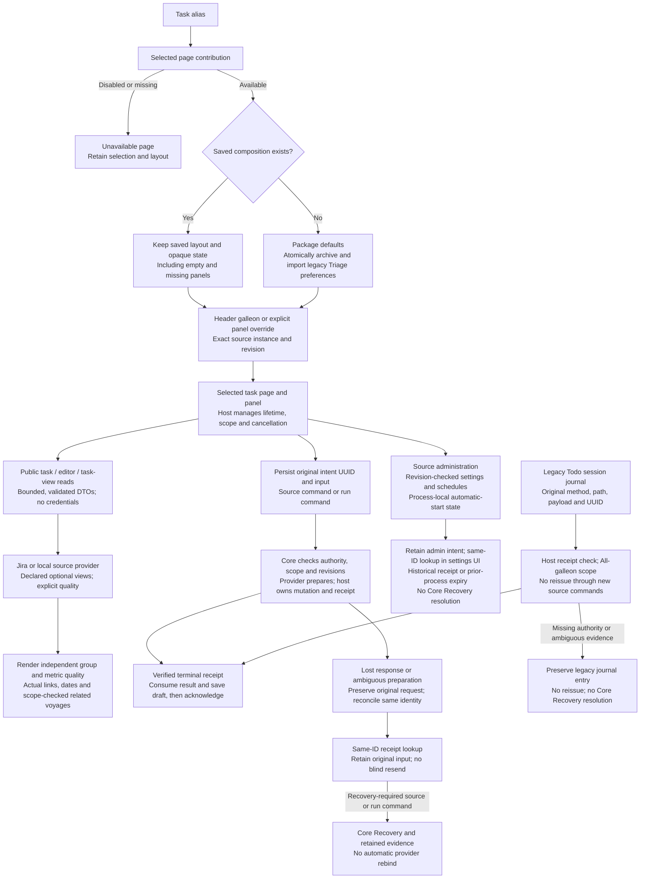
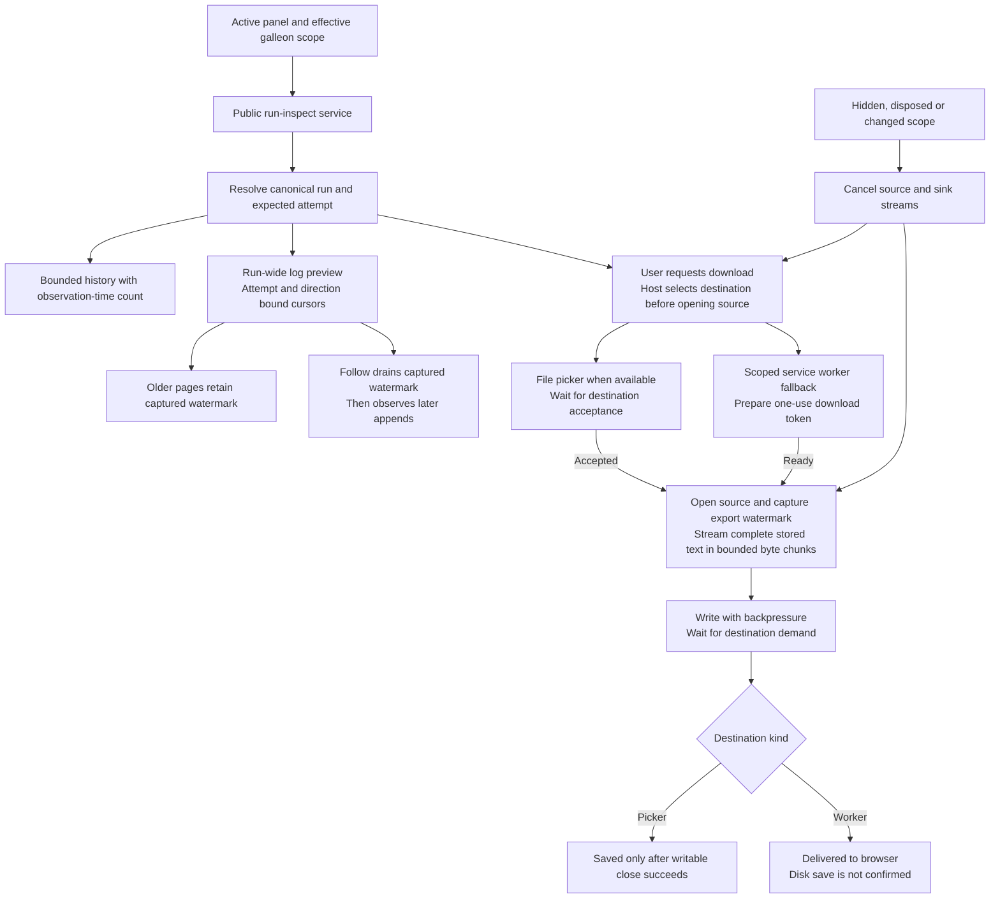
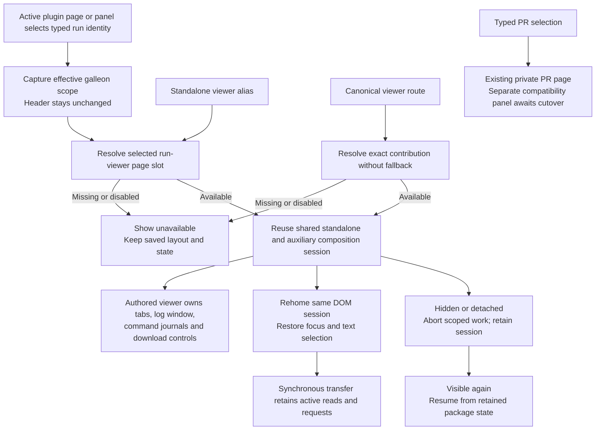
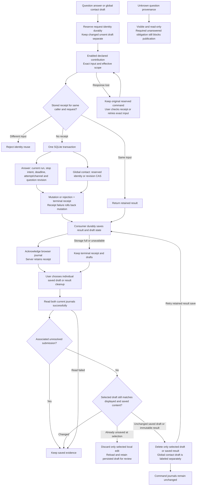
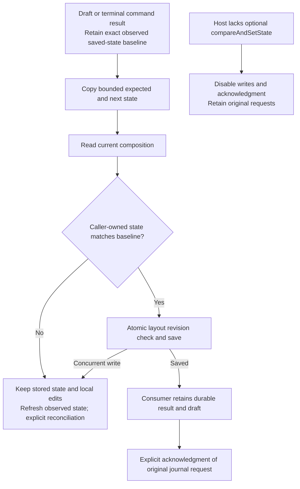
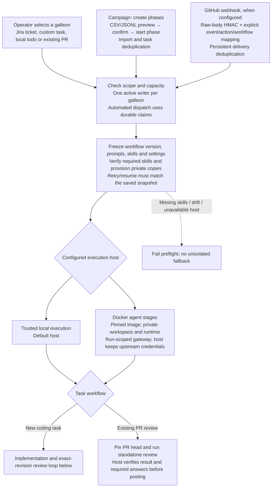
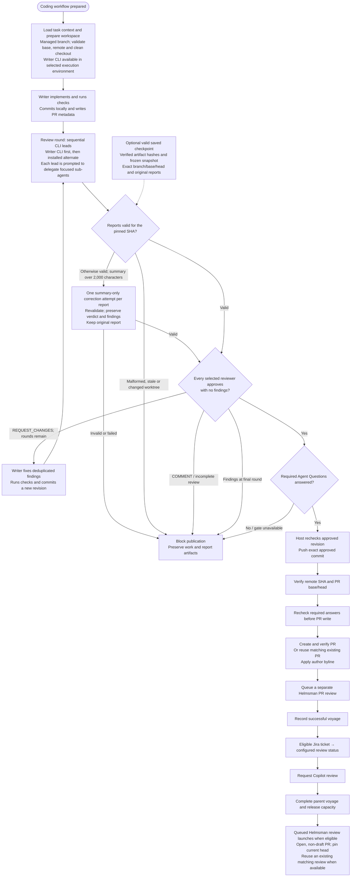
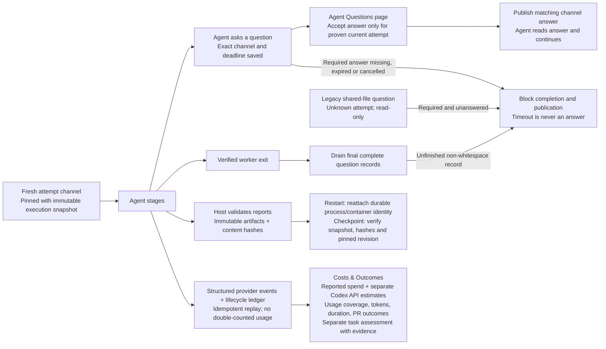

# Helmsman voyage flow

Open [helmsman-process.html](helmsman-process.html) for the standalone diagrams. They work offline and can be printed or saved as a PDF from a browser.

The flow now includes Moon Units-inspired intake, frozen execution settings, isolated agent stages, Agent Questions, durable evidence and recovery, and Costs & Outcomes. Those services surround the existing exact-revision PR review gate; they do not replace it.

## Plugin task presentation and command authority

Costs, Helm, Todos, Triage, Bugs and Source settings use public plugin services. Task aliases select their registered page implementations; core Config links to the separate Source settings page. Default task-page cutover is reviewed and pushed. E4 run inspection, bounded downloads, provisional viewer/history pages and public clarification services are reviewed and pushed as b49c6ca; shared-viewer convergence and fully authored question/contact panels are in progress; interchangeable execution/policy (F) and compatibility retirement (G) remain pending. See the [implementation ledger](plugin-implementation-progress.md).

Triage applies provider filters before pagination and preserves independent cursors under a fixed observation window. Its related voyages are enriched from canonical task claims and checked against actual runs in the selected galleon. Editor associations instead come from the provider; core verifies run existence and galleon scope without asserting claim ownership. Bugs labels approximate counts, unknown metrics and capped resolution samples separately. A source or presentation disablement denies new work while retained execution and effect obligations stay pinned. A historical automatic-start receipt never establishes the current process's enabled state. Package code is trusted; DTO and import validation do not provide a security sandbox.

## E4 foundation: run inspection and streamed downloads

This flow describes the reviewed and pushed E4 foundation. Authored viewer/history packages are available through provisional slots; the legacy `/runs` page still awaits cutover.

Log events remain run-wide because stored events have no reliable attempt provenance. An expected attempt prevents stale reads and exports; it does not attribute old events to that attempt. History totals describe the current observation within an insertion ceiling, not an immutable status snapshot. The browser fallback avoids a full-log Blob; Firefox stream cancellation does not guarantee an immediate native download failure indication. See the [E4 implementation plan](plugin-phase-e4-implementation.md) for clarification channel, durable-answer and replacement-package acceptance gates.

## E4 working slice: presentation and durable answers

These flows describe the current integration work. The existing `/runs` drawer and PR renderer remain pending cutover; clarification presentation retains an explicitly tracked compatibility bridge.

Saved browser drafts and results remain until explicit cleanup. Fresh successful journal reads protect records associated with unresolved submissions; a read failure prevents deletion. Cleanup checks the displayed and saved draft again after the journal read and rejects changed content. Discarding an already-unsaved local edit retains and reloads persisted text for review; deleting that text requires a separate action. Scoped answer drafts, saved results and the explicitly global contact draft have separate removal actions, and none deletes journal entries. Compatibility local storage does not provide an atomic transaction across tabs for the final comparison and deletion.

Answer acceptance does not prove worker consumption. Contacts are global metadata; saving them sends no messages. Disabled contributions retain browser journals and reconcile after reenablement. Legacy HTTP ingestion, ID-only answers and unversioned contact writes return 410 when the public services are active. Trusted worker ingestion still requires its retained attempt channel. See [backend contracts](clarification-backend.md) and [author lifecycle](panel-authoring.md).

## Conditional panel-state saves in development

The next E4 slice adds conditional panel-state saves for authored question/contact panels. These changes are local until their independent package and production acceptance gates pass:

## Intake and execution preparation

Manual launches inherit the header galleon unless a panel explicitly selects another. Campaign record overrides are shown in the import preview; webhook targets and workflows come only from configured mappings. Campaign phases control dispatch and concurrency; durable claims and stable run IDs allow reconciliation after uncertain launches.

In Docker mode the host supervises, verifies artifacts, and publishes; only writer/reviewer stages enter containers. Agent containers reach approved provider operations and restricted GitHub reads through a capability-scoped gateway. They receive no long-lived host credentials, unrestricted internet access, or Docker socket. Trusted local execution retains its existing host permissions.

## Coding and PR publication

## Services throughout a voyage

- **Questions:** the E4 foundation pins new channels to immutable execution attempts before preparation; recovery verifies the retained channel, and continuation receives a new one. The operator can answer proven current-attempt questions. Legacy shared-file questions remain unknown and read-only; prior or unknown required unanswered obligations still block publication. Local and Docker gates verify the retained attempt/channel pair. After verified exit, a final drain captures late questions before retry or completion; unfinished non-whitespace records block progress. Waiting retains capacity. Contacts are optional suggested respondents and never send notifications. Public answer commands now retain durable receipts; the compatibility renderer uses those services. Fully authored clarification presentation and Runs/PR cutover remain pending.
- **Evidence and recovery:** validated reports are recorded with immutable identities and hashes. A checkpoint continuation revalidates saved evidence before reusing it; legacy checkpoints without manifests follow an explicit compatibility path. A fresh retry preserves the original task/provider, workflow snapshot and Docker image pin; changed prompts or skills fail preflight. Restart reattachment and checkpoint continuation are different from restarting an entire failed voyage.
- **Costs and outcomes:** provider token/cost events and stage timing feed a persistent ledger. Reported spend can be partial; unreported billed costs stay unknown. Eligible unpriced Codex usage receives a separate Standard short-context API baseline estimate, using published rates checked September 19, 2026. The UI exposes estimated/unpriced record coverage and runs without usage records. Missing model/token data remains unknown; service tier, per-request context and cache-write usage are unavailable, and subscription charges may differ. Estimates do not affect budget caps or cost-per-PR metrics, which use fully priced runs. Process success does not itself establish task completion: assessment state (complete/partial/failed/not-assessed) is separate from task outcome (achieved/partial/not-achieved/unknown), with supporting evidence. PR visibility is best-effort with explicit stale/unavailable status.

## Defaults and boundaries

- **Defaults:** 2 desired reviewer CLIs, 3 review rounds, 45 minutes per agent session. Configuration allows 1–2 reviewers, 1–5 rounds, and 5–180 minutes. These are defaults, not a statement of current live settings.
- The writer CLI is required in the selected execution environment. An unavailable alternate CLI permits a single reviewer, even when 2 are configured. The writer's review is a fresh session, using a detached worktree locally or an isolated review workspace in Docker.
- Reviewer leads run sequentially. Their prompts request concurrent, bounded sub-agents; the runtime does not verify that delegation happened.
- Each reviewer examines the same complete committed diff. After a fix commit, every selected reviewer reviews the new revision. A `COMMENT` verdict blocks; it does not enter the fix loop.
- Summary correction applies only to an otherwise valid report. It gets one additional session per report, with its own timeout, and does not consume another review round. The 2,000-character limit uses JavaScript string length, including whitespace and any byline.
- Preflight, agent, report, revision, and publication failures stop the flow. Pre-PR voyages have one outer attempt; the runtime does not automatically restart the entire voyage. Work is retained on failure. A push may already have occurred if a later publication check fails.
- A valid saved checkpoint skips implementation and reuses the original reports for its saved review round. It must match the current branch, base, head, and complete selected reviewer set. Oversized saved summaries can use the same correction step.
- After publication, Helmsman queues its own PR review and requests Copilot. Jira transitions apply to eligible Jira tasks, not local todos or freeform tasks. Queue and Copilot request failures do not change the successful creation voyage to failed.
- The queued Helmsman review waits for the parent to finish, available capacity, and GitHub configuration. Closed, merged, or draft PRs are blocked. A matching running or successful review for the current head can be reused. The flow does not auto-merge the PR.

## Setup and current limits

- Webhooks are disabled until a secret and explicit routes are configured; public ingress is a separate deployment choice. See [webhook setup](webhooks.md).
- Docker requires a built runtime image and host provider credentials. Dependencies/cache must be supplied in the image because agent stages have no unrestricted network access. Docker branch-update reruns currently fail preflight; the operator must select trusted local execution for that mode. See [Docker execution](docker-run-host.md).
- Offline Docker lifecycle and mocked provider gateway flows were verified during adoption. A real provider-backed Docker coding/review run still requires configured host API keys; the adoption validation did not make paid provider calls.
- No path auto-merges a PR. Merging remains a human action on GitHub.

Implementation references: `server/helmsman/prepare-run.ts`, `workflow-snapshots.ts`, `campaign-dispatcher.ts`, `webhooks.ts`, `docker-stage.ts`, `scoped-gateway.ts`, `clarification-runtime.ts`, `pre-pr-runtime.ts`, `artifacts.ts`, `run-telemetry.ts`, and `outcome-service.ts`. See [adoption evidence](moonunit-adoption.md).
