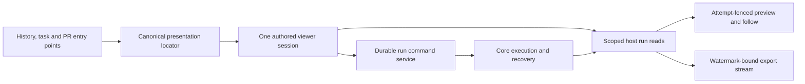
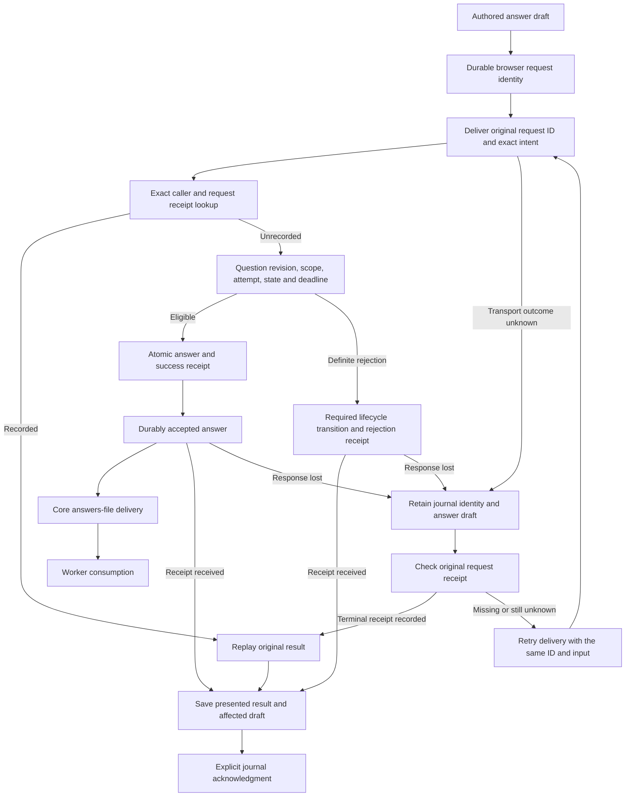

# Phase E4: run presentation and clarifications

Status: proposed next implementation batch, pending the E3 checkpoint and architectural review. No E4 runtime work is claimed complete. E4 is another slice of Phase E; it does not complete the [architecture plan](plugin-architecture-plan.md), Phase F policy replacement, or Phase G compatibility retirement. The [E3 implementation plan](plugin-phase-e3-implementation.md) remains authoritative for the preceding extraction and its acceptance gates. Record delivered work in the [completion ledger](plugin-implementation-progress.md).

## Scope and sequence

Extract run history and the shared run viewer through public reads, presentation locators and existing durable run commands. Extract clarification presentation through bounded reads and a new durable answer command. Keep suggested-contact administration explicitly global and independently available.

1. Agree on public DTOs, log/history semantics, clarification attempt provenance and migration treatment before publishing the contracts.
2. Implement the host services and failure-injection tests. Migrate owned schemas before acquiring the application writer lease.
3. Build independent run-viewer/history and clarification/contact packages against the distributed SDK. Integrate the shared viewer through a generic mounting adapter while legacy consumers remain.
4. Prove installation, replacement, reload and restart with checkout access denied; review behavior and visuals before changing active page bindings.
5. Retire legacy presentation only when every consumer and retained draft/request identity has a demonstrated replacement. Track any remaining adapter in Phase G.

Every extraction includes its documentation change: update the repository and affected package READMEs, SDK/authoring instructions, architecture and progress documents, operational/recovery guidance and affected flowcharts in the same checkpoint. Describe the actual delivered behavior and remaining compatibility paths. Documentation and diagram review are acceptance gates, not follow-up cleanup.

Core retains execution, admission, usage recording, budgets, source settlement, clarification ingestion/delivery and publication gates. Disabling either presentation package must not stop those services or make Recovery unavailable. This batch adds no browser Resume action: existing continuation increments an attempt on the same run and requires a separate protocol from launch/retry.

The proposed ownership flow is:



## Existing run seams and gaps

[`RunReadServiceV1`](../src/plugins/run-read.ts) already exposes scoped summaries, current attempts, worker outcomes, measured cost, review results and separate source settlement. Its server implementation uses signed cursors and bounded event text. The legacy viewer and history remain owned by [`src/main.ts`](../src/main.ts).

| Existing behavior | Required extension |
|---|---|
| `load` requires a known galleon; old links can contain only a run ID. | Resolve a legacy ID within the caller's effective permitted scope and return its canonical run locator. |
| Keyset list pages have `nextCursor` but no total or observation metadata. | Supply truthful totals and observation time without presenting loaded-row count as the full history size. |
| Initial public log reads return at most 50 events; the legacy preview retains 300. | Provide bounded backward paging so an authored viewer can retain the same preview depth. |
| Log cursors bind galleon/run ID but omit attempt and direction. | Fence preview and continuation against attempt changes and bind direction and watermark explicitly. |
| Legacy download streams complete text to a captured event watermark, through a run-ID-only route. | Expose scoped, attempt-fenced streaming export through the public host service. |
| One legacy drawer is rehomed among Runs, PRs, Triage and Todos. | One authored viewer must own the shared session, tabs, subscriptions, preview, copy/export, drafts and commands. |

## Proposed run contract behavior

Preserve existing `helmsman/run-read@1` consumers. Add compatible optional facets or publish a separately declared versioned facet where query/response semantics change; do not silently redefine existing cursor behavior. Freeze the exact signatures before authoring the packages.

- `resolve({ runId })` uses the effective panel scope and host-permitted galleons. It returns a canonical `{ repo, runId, attempt }` or an unavailable/not-found result without exposing foreign-scope run metadata. It never enumerates unrestricted runs in the browser.
- History reads retain bounded keyset pagination and return `total: number | null`, `observedAt` and coverage semantics. Calculate count and rows from the same permitted predicates, insertion ceiling and database read. The count is exact at that observation when available; current run statuses can change between pages. Do not describe the traversal as an immutable historical snapshot. If stable membership is required, add an explicit generation fence and reject changed continuations rather than claiming stability from the row ceiling alone.
- Preview requests include canonical galleon/run identity, `expectedAttempt`, direction, bounded limit and an opaque cursor. Cursors bind effective scope, run ID, attempt, direction and captured event watermark. Return ordered events, truthful earlier/later availability, per-event truncation and the continuation for the requested direction. Fetching older entries must not move the live-follow cursor backward.
- Retain a 300-event rendered preview and the legacy 4,000-character display bound through bounded pages. Preserve complete stored text for export; preview truncation is never evidence that the underlying log is incomplete.
- `exportLog` captures an event watermark and returns a host-owned, abortable byte stream with safe filename and content type. Stream bounded database pages with backpressure; do not collect the full log in browser memory. Bind the export to canonical scope, expected attempt and watermark. Check lifetime/scope cancellation during delivery and fail explicitly if the binding changes. Appended events beyond the watermark belong to a later export.

[`run_events`](../server/helmsman/db.ts) currently stores run ID, event ID, time, kind and text, but no attempt attribution. This batch can truthfully expose **run-wide history**, with the expected attempt acting as a concurrency fence. It must not label every old event as belonging to the current attempt. If per-attempt slices become required, first record durable attempt attribution on new events and establish verifiable historical boundaries; represent older unprovable attribution as unknown. Do not infer it from wall-clock timestamps alone.

Typed run and PR presentation locators should contain public identities, not private router objects, API paths or provider clients. The authored viewer uses existing `helmsman/run-command@1` for stop/retry and preserves command journals. PR details, human review and messaging remain dependent on their own later public ports; a viewer extraction must not copy those private clients into a plugin.

## Viewer lifecycle and compatibility

The root-owned compatibility adapter may move the selected viewer's mount between legacy slots. It does not own feature tabs, requests, log buffers or action state. Keep one logical viewer session across consumers, with explicit disposal and no duplicate pollers after rehoming.

The package owns tab selection, active-run locator, preview position, user scroll position, drafts, keyboard focus, copy behavior and pending-command presentation. Hidden, collapsed, detached or out-of-scope viewers suspend subscriptions and exports. Returning to an active scope revalidates attempt and cursor bindings. A late response cannot repaint another tab or overwrite a newer draft.

History, task and PR entry points open the same canonical viewer target. Preserve explicit missing-provider placeholders rather than choosing another implementation silently. Existing page/layout records and intentionally empty layouts stay intact during binding changes.

## Clarification reads and provenance

[`clarifications.ts`](../server/helmsman/clarifications.ts) already validates question ingestion, limits each run to 32 questions, checks deadlines and running state on answer, and manages timeout/cancellation. Current browser reads cast an unbounded array; answer requests contain only question ID and answer text. Current question rows have neither attempt provenance nor a revision used for public CAS.

Propose `helmsman/clarification-read@1` with bounded `list` and `load` operations. Queries explicitly identify galleon scope and optional canonical run; filtering precedes pagination. DTOs contain question/run identity, recorded attempt provenance, an opaque question revision, prompt, required/owner information, state, bounded answer, timestamps/deadline and explicit answerability/reason. Preserve pending, answered, timed-out and cancelled states. Empty results and unavailable reads remain distinct.

Stamp new questions with the attempt that ingested them. Existing rows may be backfilled only when the binding can be proven. A run with multiple attempts is not evidence that an old question belongs to its current attempt. Read-only legacy questions with unknown attempt provenance need an explicit reason and remain visible; do not guess a writable target. Confirm whether an attempt-one migration can be proven from retained execution evidence before allowing that backfill.

Use a stable revision over canonical question state or a durable revision counter. It must change whenever relevant answerability changes, and answer execution must separately recheck the current run attempt/status and deadline. Revision comparison alone cannot freeze time or a worker outcome.

## Durable clarification answers

Propose `helmsman/clarification-command@1` with `submit`, `receipt`, `pending` and `acknowledge`, following the existing browser-owned durable journal conventions. The submitted intent contains:

```ts
{
  version: 1,
  repo,
  runId,
  expectedAttempt,
  questionId,
  expectedQuestionRevision,
  answer
}
```

The host reserves the request ID; the caller cannot inject a fresh UUID to reinterpret an unresolved answer. Persist immutable caller, target and canonical input. An exact retry returns the original receipt; a changed answer or target under that request ID conflicts. Distinct tabs answering the same revision race through CAS, producing one applied answer and a durable rejection for the loser.

Commit the answer transition and success receipt in the same database transaction. Check exact question/galleon/run/attempt binding, pending state, active worker and deadline at commit. Resolve recorded receipts before current deadline/run-status gates, including after restart and response loss. Acknowledgment requires a recorded terminal result and follows saving the affected draft/result; cancellation of the current scope must not delete an unknown request.

The current store's `answer` method may change a pending question to cancelled or timed-out **before throwing**. The new coordinator must model these transitions intentionally: commit the required terminal question state with its definite rejection receipt, or let the core lifecycle transition establish it before command evaluation. A blanket exception rollback must not silently undo a required timeout/cancellation. Storage failure after a successful answer must roll back both answer and receipt.

A success receipt proves the answer was durably accepted. It does not prove the worker already consumed the answers file. Keep delivery state separate if exposed. Core continues to own question-file ingestion, answers-file publication, timeout/cancellation and the required-answer publication gate. The presentation plugin cannot weaken those checks or author arbitrary worker protocol records.

The proposed answer flow preserves that distinction:



## Suggested-contact boundary

Use a separate explicitly global administration capability, provisionally `helmsman/suggested-contact-admin@1`, for bounded contact reads and revision-checked durable saves. Preserve the existing public name, account ID/address and enabled fields, with independent contact revisions and host-reserved create identities. Global contact settings must not inherit a misleading galleon target or be treated as permission to answer a foreign-scope question.

Saving a suggested contact only changes contact metadata; the port has no notification/send capability. Core retains contact selection policy at question ingestion. Contact-read or contact-save failures must not hide otherwise available questions, clear answer drafts, or block answering. The authored contact settings can share a page with clarifications while retaining their independent service and error boundary.

## Ownership and review

| Owner | Bounded responsibility |
|---|---|
| Root | Freeze contracts/versioning; central SDK/service/router wiring; canonical presentation locators and generic legacy mounting adapter; migration startup ordering; page-binding cutover; integration build/checkpoint commit and exact-commit architectural review. |
| Backend | Run DB/read extensions, cursor and export fencing, scoped resolver, browser read adapter; clarification provenance migration, bounded reads, durable answer/contact coordinators and journals; transaction/cancellation/restart tests. |
| Host | Independent run-viewer and history packages; authored clarification/contact presentation; tabs, drafts, focus/scroll, subscriptions, pending receipts and canonical navigation; standalone package manifests/builds and browser/visual tests. |
| Costs/review | Independent review of scope, attribution, pagination truthfulness, immutable command identity and failure recovery; cross-package source-denied installation proof and adversarial gate review. |

Each owner updates the READMEs, reference docs and flowcharts affected by their slice. Root checks the repository-wide documentation and completion ledger against the final integrated behavior before the checkpoint commit; the exact-commit review includes those artifacts.

Implementation and independent review may run concurrently once contracts stabilize. Root owns release/distribution builds so concurrent agents do not overwrite their outputs. Findings affecting public semantics return to contract review before cutover.

## Acceptance gates

- Run resolution rejects foreign scope without disclosing metadata. History handles concurrent inserts/status changes, malformed cursors, permitted-galleon changes, empty pages and totals without inventing snapshot guarantees.
- Preview and follow handle backward/forward paging, large Unicode events, exact truncation indicators, empty logs, duplicate/rebound cursors and attempt changes. Export excludes later appends, streams large logs with bounded memory, respects backpressure/cancellation and never switches run or attempt midstream.
- One viewer survives rehoming, browser reload and tab changes without duplicate watchers. Hidden/disposed scopes stop work. Keyboard focus, user scroll and unfinished drafts survive refreshes; unrelated source/PR outages do not fabricate worker success or settlement.
- Clarification tests cover provable/unknown legacy provenance, response loss, conflicting tabs, deadline/run-stop/attempt races, durable rejection, receipt-store rollback, restart replay, malformed payloads and cancellation during journal acknowledgment.
- Answer acceptance remains distinct from delivery. Disabling presentation leaves ingestion, timeout, answers-file delivery, required-answer publication gates and Recovery operational.
- Contact tests cover global-versus-galleon boundaries, failed contact reads alongside successful question reads, duplicate create retries, stale contact revisions and absence of notification effects.
- Build the application and distributed SDK; run TypeScript, relevant unit/integration and visual tests. Independently compile/install the authored packages outside the checkout, deny source access, reload/restart and exercise actual public routes. Record any remaining legacy adapter or unsupported provenance explicitly before declaring cutover complete.
- Verify affected READMEs, contract/authoring examples, architecture diagrams, command/delivery/recovery flowcharts and the progress ledger against the final implementation. Check links and examples; show retained compatibility paths and unknown outcomes explicitly. Do not mark an extraction complete while these artifacts describe an earlier flow.

_Helmsman · not reported - not reported_
