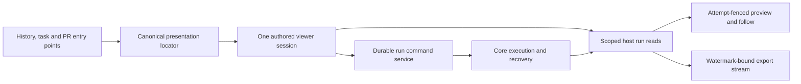
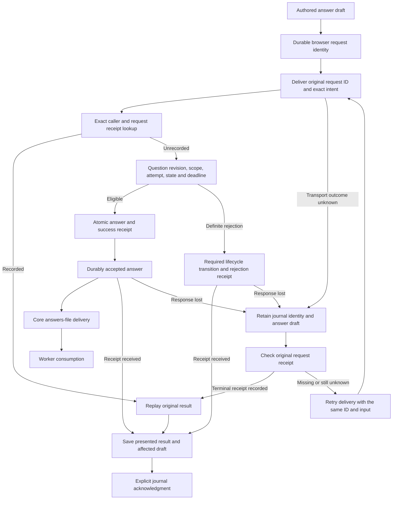
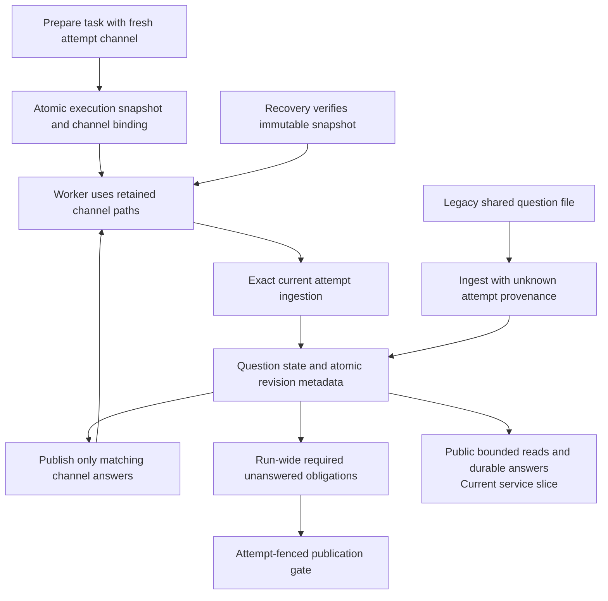

# Phase E4: run presentation and clarifications

Delivery update: implementation has resumed under the revised delivery cadence. The [remaining delivery plan](plugin-remaining-delivery-plan.md) supersedes earlier work sequencing and test/review frequency; the original A–G scope and final acceptance gates remain in force.

Status: implementation underway after the reviewed and pushed E3 task-page cutover (`d21d9cb`). The run-inspect, streaming-download and clarification attempt-channel foundations are reviewed and pushed as `e788774`, including terminal-drain corrections. Provisional viewer/history pages, bounded clarification reads and durable answer/contact contracts are reviewed and pushed as `b49c6ca`. Shared standalone/auxiliary viewer convergence, canonical-only authored question/contact panels and conditional panel-state saves are reviewed and pushed as `773cce4`, including exact-request clarification/contact retry. Sibling run/source retry corrections are reviewed and pushed as `9142966`. The current increment binds the clarification alias to authored panels, extracts a private shared PR compatibility session and adds public PR inspection; production acceptance and independent exact-commit review passed; `3806090` is pushed and verified. Clarification recovery is reviewed and pushed as `ab0757d`. The Runs alias now selects an authored composition; focused checks, TypeScript/distribution build, four production scenarios and eight affected browser tests passed. Runs and its validation correction are reviewed and pushed as `56e6d60`; remote SHA verified. Public PR/GitHub extraction has passed focused build and production acceptance; independent exact-commit review and push are next. The candidate removes the private PR session and legacy drawer, with public durable review commands and replaceable provider selection. Clarification recovery retains the original caller and raw storage inside its package, without a bulk state migration. E4 is another slice of Phase E; it does not complete the [architecture plan](plugin-architecture-plan.md), Phase F policy replacement, or Phase G compatibility retirement. The [E3 implementation plan](plugin-phase-e3-implementation.md) remains authoritative for the preceding extraction and its acceptance gates. Record delivered work in the [completion ledger](plugin-implementation-progress.md).

## Scope and sequence

Extract run history and the shared run viewer through public reads, presentation locators and existing durable run commands. Extract clarification presentation through bounded reads and a new durable answer command. Keep suggested-contact administration explicitly global and independently available.

1. Agree on public DTOs, log/history semantics, clarification attempt provenance and migration treatment before publishing the contracts.
2. Implement the host services and failure-injection tests. Migrate owned schemas before acquiring the application writer lease.
3. Build independent run-viewer/history and clarification/contact packages against the distributed SDK. Integrate the shared viewer through a generic mounting adapter while legacy consumers remain.
4. Prove installation, replacement, reload and restart with checkout access denied; review behavior and visuals before changing active page bindings.
5. Retire legacy presentation only when every consumer and retained draft/request identity has a demonstrated replacement. Track any remaining adapter in Phase G.

Every extraction includes its documentation change: update the repository and affected package READMEs, SDK/authoring instructions, architecture and progress documents, operational/recovery guidance and affected flowcharts in the same checkpoint. Describe the actual delivered behavior and remaining compatibility paths. Documentation and diagram review are acceptance gates, not follow-up cleanup.

Core retains execution, admission, usage recording, budgets, source settlement, clarification ingestion/delivery and publication gates. Disabling either presentation package must not stop those services or make Recovery unavailable. This batch adds no browser Resume action: existing continuation increments an attempt on the same run and requires a separate protocol from launch/retry.

The proposed ownership flow is:



## Design baseline: existing run seams and gaps

[`RunReadServiceV1`](../src/plugins/run-read.ts) already exposes scoped summaries, current attempts, worker outcomes, measured cost, review results and separate source settlement. Its server implementation uses signed cursors and bounded event text. The legacy viewer and history remain owned by [`src/main.ts`](../src/main.ts).

| Existing behavior | Required extension |
|---|---|
| `load` requires a known galleon; old links can contain only a run ID. | Resolve a legacy ID within the caller's effective permitted scope and return its canonical run locator. |
| Keyset list pages have `nextCursor` but no total or observation metadata. | Supply truthful totals and observation time without presenting loaded-row count as the full history size. |
| Initial public log reads return at most 50 events; the legacy preview retains 300. | Provide bounded backward paging so an authored viewer can retain the same preview depth. |
| Log cursors bind galleon/run ID but omit attempt and direction. | Fence preview and continuation against attempt changes and bind direction and watermark explicitly. |
| Legacy download streams complete text to a captured event watermark, through a run-ID-only route. | Expose scoped, attempt-fenced streaming export through the public host service. |
| One legacy drawer is rehomed among Runs, PRs, Triage and Todos. | One authored viewer must own the shared session, tabs, subscriptions, preview, copy/export, drafts and commands. |

## Proposed run contract behavior

Preserve existing `helmsman/run-read@1` consumers. Add compatible optional facets or publish a separately declared versioned facet where query/response semantics change; do not silently redefine existing cursor behavior. Freeze the exact signatures before authoring the packages.

- `resolve({ runId })` uses the effective panel scope and host-permitted galleons. It returns a canonical `{ repo, runId, attempt }` or an unavailable/not-found result without exposing foreign-scope run metadata. It never enumerates unrestricted runs in the browser.
- History reads retain bounded keyset pagination and return `total: number | null`, `observedAt` and coverage semantics. Calculate count and rows from the same permitted predicates, insertion ceiling and database read. The count is exact at that observation when available; current run statuses can change between pages. Do not describe the traversal as an immutable historical snapshot. If stable membership is required, add an explicit generation fence and reject changed continuations rather than claiming stability from the row ceiling alone.
- Preview requests include canonical galleon/run identity, `expectedAttempt`, direction, bounded limit and an opaque cursor. Cursors bind effective scope, run ID, attempt, direction and captured event watermark. Return ordered events, truthful earlier/later availability, per-event truncation and the continuation for the requested direction. Fetching older entries must not move the live-follow cursor backward.
- Retain a 300-event rendered preview and the legacy 4,000-character display bound through bounded pages. Preserve complete stored text for export; preview truncation is never evidence that the underlying log is incomplete.
- `exportLog` captures an event watermark and returns a host-owned, abortable byte stream with safe filename and content type. Stream bounded database pages with backpressure; do not collect the full log in browser memory. Bind the export to canonical scope, expected attempt and watermark. Check lifetime/scope cancellation during delivery and fail explicitly if the binding changes. Appended events beyond the watermark belong to a later export.

[`run_events`](../server/helmsman/db.ts) currently stores run ID, event ID, time, kind and text, but no attempt attribution. This batch can truthfully expose **run-wide history**, with the expected attempt acting as a concurrency fence. It must not label every old event as belonging to the current attempt. If per-attempt slices become required, first record durable attempt attribution on new events and establish verifiable historical boundaries; represent older unprovable attribution as unknown. Do not infer it from wall-clock timestamps alone.

Typed run and PR presentation locators should contain public identities, not private router objects, API paths or provider clients. The authored viewer uses existing `helmsman/run-command@1` for stop/retry and preserves command journals. PR details, human review and messaging remain dependent on their own later public ports; a viewer extraction must not copy those private clients into a plugin.

## Viewer lifecycle and compatibility

The root-owned compatibility adapter may move the selected viewer's mount between legacy slots. It does not own feature tabs, requests, log buffers or action state. Keep one logical viewer session across consumers, with explicit disposal and no duplicate pollers after rehoming.

The package owns tab selection, active-run locator, preview position, user scroll position, drafts, keyboard focus, copy behavior and pending-command presentation. Hidden, collapsed, detached or out-of-scope viewers suspend subscriptions and exports. Returning to an active scope revalidates attempt and cursor bindings. A late response cannot repaint another tab or overwrite a newer draft.

History, task and PR entry points open the same canonical viewer target. Preserve explicit missing-provider placeholders rather than choosing another implementation silently. Existing page/layout records and intentionally empty layouts stay intact during binding changes.

## Clarification reads and provenance

[`clarifications.ts`](../server/helmsman/clarifications.ts) already validates question ingestion, limits each run to 32 questions, checks deadlines and running state on answer, and manages timeout/cancellation. At the E4 design baseline, browser reads cast an unbounded array, answer requests contained only question ID and answer text, and question rows lacked proven attempt metadata and public CAS revisions. The delivered foundation added companion provenance/revision records; the current service slice adds bounded reads and revision-checked commands.

Propose `helmsman/clarification-read@1` with bounded `list` and `load` operations. Queries explicitly identify galleon scope and optional canonical run; filtering precedes pagination. DTOs contain question/run identity, recorded attempt provenance, an opaque question revision, prompt, required/owner information, state, bounded answer, timestamps/deadline and explicit answerability/reason. Preserve pending, answered, timed-out and cancelled states. Empty results and unavailable reads remain distinct.

Bind new questions to the durable channel retained by their producing attempt. Existing rows may be backfilled only when the binding can be proven. A run with multiple attempts is not evidence that an old question belongs to its current attempt. Legacy shared-file questions remain explicitly `legacy-unproven`; the store rejects new answers, including through the compatibility HTTP route. The forthcoming presentation contract must show that read-only reason. No attempt-one backfill is performed, because the existing shared channel does not prove the producer's attempt.

Use a stable revision over canonical question state or a durable revision counter. It must change whenever relevant answerability changes, and answer execution must separately recheck the current run attempt/status and deadline. Revision comparison alone cannot freeze time or a worker outcome.

## Durable clarification answers

Propose `helmsman/clarification-command@1` with `submit`, `receipt`, `pending` and `acknowledge`, following the existing browser-owned durable journal conventions. The submitted intent contains:

```ts
{
  version: 1,
  repo,
  runId,
  expectedAttempt,
  questionId,
  expectedQuestionRevision,
  answer
}
```

The host reserves the request ID; the caller cannot inject a fresh UUID to reinterpret an unresolved answer. Persist immutable caller, target and canonical input. An exact retry returns the original receipt; a changed answer or target under that request ID conflicts. Distinct tabs answering the same revision race through CAS, producing one applied answer and a durable rejection for the loser.

Commit the answer transition and success receipt in the same database transaction. Check exact question/galleon/run/attempt binding, pending state, active worker and deadline at commit. Resolve recorded receipts before current deadline/run-status gates, including after restart and response loss. Acknowledgment requires a recorded terminal result and follows saving the affected draft/result; cancellation of the current scope must not delete an unknown request.

The current store's `answer` method may change a pending question to cancelled or timed-out **before throwing**. The new coordinator must model these transitions intentionally: commit the required terminal question state with its definite rejection receipt, or let the core lifecycle transition establish it before command evaluation. A blanket exception rollback must not silently undo a required timeout/cancellation. Storage failure after a successful answer must roll back both answer and receipt.

A success receipt proves the answer was durably accepted. It does not prove the worker already consumed the answers file. Keep delivery state separate if exposed. Core continues to own question-file ingestion, answers-file publication, timeout/cancellation and the required-answer publication gate. The presentation plugin cannot weaken those checks or author arbitrary worker protocol records.

The proposed answer flow preserves that distinction:



## Suggested-contact boundary

Use a separate explicitly global administration capability, provisionally `helmsman/suggested-contact-admin@1`, for bounded contact reads and revision-checked durable saves. Preserve the existing `name`, `address`, `enabled` and `createdAt` fields, with independent contact revisions and host-reserved create identities. Global contact settings must not inherit a misleading galleon target or be treated as permission to answer a foreign-scope question.

Saving a suggested contact only changes contact metadata; the port has no notification/send capability. Core retains contact selection policy at question ingestion. Contact-read or contact-save failures must not hide otherwise available questions, clear answer drafts, or block answering. The authored contact settings can share a page with clarifications while retaining their independent service and error boundary.

## Ownership and review

| Owner | Bounded responsibility |
|---|---|
| Root | Freeze contracts/versioning; central SDK/service/router wiring; canonical presentation locators and generic legacy mounting adapter; migration startup ordering; page-binding cutover; integration build/checkpoint commit and exact-commit architectural review. |
| Backend | Run DB/read extensions, cursor and export fencing, scoped resolver, browser read adapter; clarification provenance migration, bounded reads, durable answer/contact coordinators and journals; transaction/cancellation/restart tests. |
| Host | Independent run-viewer and history packages; authored clarification/contact presentation; tabs, drafts, focus/scroll, subscriptions, pending receipts and canonical navigation; standalone package manifests/builds and browser/visual tests. |
| Costs/review | Independent review of scope, attribution, pagination truthfulness, immutable command identity and failure recovery; cross-package source-denied installation proof and adversarial gate review. |

Each owner updates the READMEs, reference docs and flowcharts affected by their slice. Root checks the repository-wide documentation and completion ledger against the final integrated behavior before the checkpoint commit; the exact-commit review includes those artifacts.

Implementation and independent review may run concurrently once contracts stabilize. Root owns release/distribution builds so concurrent agents do not overwrite their outputs. Findings affecting public semantics return to contract review before cutover.

## Acceptance gates

- Run resolution rejects foreign scope without disclosing metadata. History handles concurrent inserts/status changes, malformed cursors, permitted-galleon changes, empty pages and totals without inventing snapshot guarantees.
- Preview and follow handle backward/forward paging, large Unicode events, exact truncation indicators, empty logs, duplicate/rebound cursors and attempt changes. Export excludes later appends, streams large logs with bounded memory, respects backpressure/cancellation and never switches run or attempt midstream.
- One viewer survives rehoming, browser reload and tab changes without duplicate watchers. Hidden/disposed scopes stop work. Keyboard focus, user scroll and unfinished drafts survive refreshes; unrelated source/PR outages do not fabricate worker success or settlement.
- Clarification tests cover provable/unknown legacy provenance, response loss, conflicting tabs, deadline/run-stop/attempt races, durable rejection, receipt-store rollback, restart replay, malformed payloads and cancellation during journal acknowledgment.
- Answer acceptance remains distinct from delivery. Disabling presentation leaves ingestion, timeout, answers-file delivery, required-answer publication gates and Recovery operational.
- Contact tests cover global-versus-galleon boundaries, failed contact reads alongside successful question reads, duplicate create retries, stale contact revisions and absence of notification effects.
- Build the application and distributed SDK; run TypeScript, relevant unit/integration and visual tests. Independently compile/install the authored packages outside the checkout, deny source access, reload/restart and exercise actual public routes. Record any remaining legacy adapter or unsupported provenance explicitly before declaring cutover complete.
- Verify affected READMEs, contract/authoring examples, architecture diagrams, command/delivery/recovery flowcharts and the progress ledger against the final implementation. Check links and examples; show retained compatibility paths and unknown outcomes explicitly. Do not mark an extraction complete while these artifacts describe an earlier flow.

_Helmsman · not reported - not reported_

## Refined implementation boundaries

Use a separately declared `helmsman/run-inspect@1` facet rather than changing `run-read@1` cursor and text-limit semantics. It supplies scoped legacy-ID resolution, counted history with observation/coverage metadata, attempt-fenced backward/forward preview and watermark-bound export. Existing run-read consumers remain unchanged. Log provenance is explicitly run-wide. Backward pages retain their captured watermark and never replace the live-follow cursor; forward continuation drains its current watermark before observing subsequent appends. History totals share count/list predicates and a database read, but current-state changes between pages must remain visible rather than being described as an immutable snapshot.

The legacy exporter pages whole event rows. A bounded row count alone does not bound bytes when one event is arbitrarily large. The new export must iterate bounded text chunks, preserve Unicode and backpressure, and cancel its underlying reader on lifetime/scope/attempt changes. Prove a browser download sink that does not collect a complete Blob before claiming export parity.

Clarification provenance requires a durable per-attempt channel before writable plugin contracts. The compatibility runtime used run-wide question files across retries; stamping the current attempt on ingestion would misattribute old unread lines. The foundation creates a channel before prompt/adapter preparation, pins its identity and paths in the immutable execution snapshot, and binds ingestion and answer delivery to that retained channel. It covers fresh launches, automatic retries, recovery and pre-PR continuation. Existing shared-channel records remain unknown; the forthcoming public answer contract must keep them read-only. Attempt number or wall-clock timing alone is insufficient evidence for backfill.

The foundation preserves the `compat.clarifications@1` checksum and adds `core.clarification-protocol@1` with companion question/contact revision metadata and immutable attempt-channel records. Legacy rows initialize with unknown provenance and revision 1, without changing their state. Named, versioned SQLite triggers update revisions atomically with compatibility and new mutations; startup verifies their exact definitions. `openClarificationStore` initializes the companion schema after the compatibility tables, before the application writer lease. The following service slice adds `core.public-clarification-receipts@1` for answer/contact receipts and bounded-listing indexes without changing either published checksum; the application initializes it before the writer lease too.

Expose bounded `clarification-read@1`, durable `clarification-command@1` and explicitly global `suggested-contact-admin@1` services. Answer admission rechecks canonical question/channel/attempt identity, revision, worker state, persisted stop intent and deadline inside the answer-plus-receipt transaction. Replay exact receipts before current eligibility checks; changed input under an existing request ID conflicts. Answer success means durable acceptance, not successful downstream delivery. Unknown ownership remains unknown. Browser journals preserve unresolved answer identity while allowing a separate unsent draft; contact creation reserves its identity once. Contact availability is independent from question/answer availability, and saving contacts never sends a message.

Retire or constrain legacy ID-only answer/contact and unverified ingestion POST paths at cutover so they cannot bypass the new authority checks. Core ingestion, timeouts, delivery and publication gates remain active when presentation packages are disabled.

### Clarification channel ownership

The host generates a channel with run ID, attempt number, random channel ID and dedicated question/answer paths. The task carries it before preparation. Durable admission commits the channel binding with the prepared execution snapshot; failure rolls both back. Recovery verifies the existing binding and never rewrites a retained snapshot. A subsequent attempt receives a fresh channel, including when continuing a preserved pre-PR checkpoint.

The runtime ingests channel records only while their exact attempt is current. Replaying an unknown or differently bound question ID cannot promote it to the new channel. Complete legacy shared-file records are ingested separately with unknown attempt provenance, so an unread required question cannot disappear during upgrade. Active polling waits for partial lines to complete. After verified worker exit, a final attempt-fenced poll ingests the last complete records before terminal processing or retry. Any non-whitespace unterminated suffix in either question file blocks that processing, including valid JSON without its required newline; the current attempt and channel remain retained for investigation. Whitespace-only suffixes are allowed. Terminal effect authorization applies the same final-file validation. Exact existing records can replay after success without changing their answer or revision; new or conflicting terminal records are rejected. Delivery includes only the selected channel's terminal questions; legacy answers never enter a new attempt's file. Completion cancels only its channel's pending questions.

Required-answer obligations remain run-wide: prior and unknown required questions continue to block publication when unanswered. Channel isolation does not resolve those obligations or prove answer consumption. Disabling presentation changes none of these core responsibilities. The foundation retained old answer/contact routes temporarily. The current service slice rejects their writes (and raw HTTP ingestion) with 410 while public services are active; compatibility GETs remain. The compatibility renderer now uses the public durable adapters.



Focused tests exercise populated legacy-schema adoption, unchanged compatibility checksums, revision and admission rollback, trigger corruption, partial/repeated lines, unknown and cross-channel question identities, scoped answer delivery, real-worker automatic retries and lost-launch recovery, and checkpoint continuation without snapshot rewriting. Public reads, durable answer receipts and global contact administration are now implemented locally as the following service slice; presentation cutover and acceptance remain separate gates. The [backend guide](clarification-backend.md) records the implemented routes, transaction boundaries and tests.

## Public clarification and contact service slice

The contracts and transaction rules below are the agreed implementation baseline for the current service slice. They are not implemented or accepted by the run-inspect/channel foundation checkpoint. Root owns final contract registration and central wiring; costs/review owns browser contracts, codecs, adapters and journals; backend owns server coordinators, bounded queries and receipt stores; host owns the independently authored presentation packages and their installation/browser tests. These assignments supersede the broader ownership table for this slice.

### Bounded clarification reads

`helmsman/clarification-read@1` exposes `list({ version: 1, repo, runId, states, limit, cursor }, signal?)` and `load({ version: 1, repo, runId, questionId }, signal?)`. List accepts a nullable repository/run filter, a validated set of existing question states, a limit from 1 through 100, and a nullable opaque cursor. Load requires an exact repository/run/question identity. Effective host scope and configured repositories constrain both operations before filtering or pagination; a caller cannot broaden scope by supplying `repo: null`. Foreign and absent identities produce the same not-found result.

Each question DTO contains `version: 1`, `id`, `runId`, `repo`, positive `revision`, `prompt`, `required`, `owner`, `contactId`, `state`, `answer`, `createdAt`, `timeoutAt` and `answeredAt`. `prompt` maps the existing stored `question`; nullable fields remain nullable. Additional fields are:

| Field | Contract |
|---|---|
| `provenance` | Either `{ kind: 'attempt-channel', attempt, channelId }` or `{ kind: 'legacy-unproven', attempt: null, channelId: null }`. |
| `currentAttempt` | Current run attempt, or `null` when unavailable. This does not assign provenance. |
| `blocksPublication` | `required && state !== 'answered'`, including unknown, prior-attempt, cancelled and timed-out obligations. |
| `answerability` | `{ available: true, reason: null }` or `{ available: false, reason }`, where reason is `provenance-unknown`, `different-attempt`, `not-pending`, `run-unavailable`, `run-inactive`, `stop-requested`, `deadline-expired` or `channel-unavailable`. This is observed guidance; submission rechecks eligibility atomically. |

List returns `{ version: 1, repo, items, nextCursor, total, observedAt }`, with `total: number | null` describing the complete scoped/filter-matched set at observation time, not the remaining cursor suffix. Rows/count use the same database observation; mutable state across pages is not an immutable snapshot. Cursors bind scope, configured repositories, filters and ordering. Results expose no channel file paths, gate URLs/tokens or raw execution snapshots. Question reads do not depend on contact reads. Unknown provenance remains visible and read-only; adoption or waiver of old obligations is outside this slice.

### Durable answer admission

`helmsman/clarification-command@1` accepts immutable answer intent `{ version: 1, repo, runId, questionId, expectedAttempt, expectedChannelId, expectedQuestionRevision, answer }`. Attempts/revisions must be positive integers and identity fields must validate. The adapter trims the answer once before journal reservation and preserves the existing nonempty, maximum 4000 UTF-16-code-unit semantics. The authored component preserves its editable draft separately from that canonical intent.

The public operations are `submit(input, signal?)`, `receipt({ repo, requestId }, signal?)`, `pending()` and `acknowledge({ repo, requestId }, signal?)`. The host reserves request IDs; a plugin cannot choose or replace one. Resubmitting the same unresolved canonical intent uses its original identity. A receipt contains the immutable input and request ID, terminal `succeeded` or `rejected` status, and the result or rejection reason. Success returns the exact question ID, resulting revision, canonical answer and `answeredAt`. It proves durable acceptance only. Synchronous local database effects need terminal server receipts; a lost/unknown transport outcome remains a browser journal entry without a known receipt.

Admission uses one shared database transaction:

1. Validate the host-recognized contribution caller, effective scope and canonical payload, then enter `BEGIN IMMEDIATE`.
2. Look up the exact caller/request receipt before checking current run, attempt or deadline. Identical input replays the recorded terminal result; changed input under that identity conflicts.
3. Read the question/revision/provenance, immutable channel binding and execution snapshot, current run attempt/state, persisted stop intent and current deadline from the same database transaction. Missing or corrupt channel/snapshot evidence fails closed.
4. Compare-and-set the exact question identity, revision and pending state. Commit the answer, trigger-maintained revision and success receipt together.
5. Record definite rejection in that transaction. Any required timeout/cancellation transition commits with its rejection receipt; throwing must not accidentally roll the transition back. Receipt storage failure rolls all answer, revision and lifecycle changes back.

There is no asynchronous worker or file I/O inside admission. Core ingestion, timeout/cancellation, answers-file delivery and publication gates retain their independent responsibilities. Stop intent denies a new answer even while the worker row still reports running. An exact accepted receipt remains replayable after stop, deadline expiry, attempt change and process restart.

### Browser answer journal

Use an IndexedDB reservation key of caller, repository, run ID and question ID. Keying by answer text or mutable revision would permit multiple unresolved identities for the same question. An existing unresolved reservation accepts only identical canonical intent; changed text or revision is rejected until its terminal result is recorded and explicitly acknowledged. New edits remain a separate unsent draft. Separate callers still race through server revision checks, producing one accepted mutation and a durable stale rejection.

The journal provides `reserve(input, signal)`, `record(receipt)`, `pending()` and `acknowledge(query, signal)`, with a bounded maximum of 256 pending entries and 8 MiB of encoded pending payloads per caller. Recording verifies exact identity and canonical input. Acknowledgment removes only a recorded terminal result after the consumer saves its draft/result state. Abort, unmount, reload or response loss never deletes an unknown request identity. Cross-tab reservation is transactional, and retries reuse the retained request rather than allocating another.

### Global suggested-contact administration

`helmsman/suggested-contact-admin@1` uses an explicit `scope: 'global'` and no repository field. It exposes bounded cursor-based list/read operations and durable create/update submission, receipt, pending and acknowledgment operations with the same immutable-input and terminal-receipt conventions. List includes `observedAt`; limits are 1 through 100. Global service access neither inherits the invoking galleon nor authorizes foreign question access.

The contact DTO is `{ id, revision, name, address, enabled, createdAt }`, preserving the actual `TrustedContact` model. Names and addresses are trimmed, nonempty strings of at most 160 and 320 UTF-16 code units respectively; address remains arbitrary text, not email-only. `enabled` is an explicit boolean in create/update inputs. Existing IDs retain the current case-insensitive `[a-z0-9_-]` validation with length 1 through 128. Updates require `expectedRevision` and preserve `createdAt`.

For create, the browser journal atomically reserves both a request UUID and contact UUID before delivery and retains them in the immutable command. Retries reuse both; server insertion and terminal receipt commit together, preventing duplicate contacts after response loss. The journal allows one unresolved create reservation per caller; an identical retry reuses it and a different create draft waits for acknowledgment. Update reservations are keyed by caller/contact ID and enforce revision compare-and-set. Separate callers may deliberately create separate contacts with identical metadata; this is not address-based deduplication.

Contact saves change metadata only and never send notifications. Contact failure must not hide questions, clear drafts or block answer submission. Receipt tables use a new owned schema rather than modifying the published companion-schema checksum; migrations complete before acquiring the writer lease. At cutover, retire or constrain legacy ID-only answer/contact and unverified-ingestion write routes so they cannot bypass durable admission.

### Planned viewer composition

The generic auxiliary host reuses the selected page-slot/composition lifecycle and rehomes a stable DOM instance. An optional typed presentation locator and selection callback travel from page to panel; locator comparisons are structural. The locator baseline is:

```ts
type PresentationLocatorV1 =
  | { version: 1; kind: 'run'; repo: string; runId: string }
  | { version: 1; kind: 'legacy-run'; runId: string }
  | { version: 1; kind: 'pull-request'; repo: string; number: number };
```

The public selection callback accepts a locator or null; the host captures the caller's effective scope and activity internally. Reject inactive callers and canonical targets outside a concrete caller scope. Resolve legacy IDs only within that effective scope. An explicit panel override may scope the auxiliary presentation without changing the header. Presentation locators do not freeze an execution attempt: the package resolves the current attempt separately and keeps unresolved command identity immutable. Missing/disabled selections remain unavailable without fallback. The generic presentation adapter owns no feature tab arrays, log buffers or polling state; the separate legacy `/prs` owner remains pending retirement.

The Runs composition contains independently authored history and public PR panels. PR routes now select the same SDK-only PR composition, and run selection uses the existing shared auxiliary viewer. The private PR session and legacy drawer are removed in the active PR/GitHub increment. Manual review requests use the public browser journal and durable operation ledger; optional Slack controls remain in a narrow Config surface until the following Slack milestone. Feature acceptance is tracked in the implementation ledger.

### Next-slice acceptance additions

- Unknown and prior-attempt required questions remain visible, blocking and read-only; missing/corrupt channel or snapshot evidence fails closed.
- Persisted stop intent prevents admission while a run still reports running. Exact receipt replay survives stop, expiry, attempt change and restart; altered input with the same request conflicts.
- Concurrent tabs reserve consistently and conflicting server submissions produce one success. Response loss preserves original identity and draft. Timeout/cancellation rejections commit their lifecycle transition, and receipt failure rolls it back.
- Global contacts preserve name/address/enabled semantics; create retry cannot duplicate, stale update revisions reject, and contact outage leaves question reads and answers available. No save sends a message and no answer receipt claims worker consumption.
- Authored viewer selection preserves effective scope, stable panel state and rehoming lifecycle. PR compatibility remains explicitly accounted for until extraction. Independent SDK-only package installation, public-route tests and visual cutover proof are required before claiming the presentation slice complete.

### Exact-request retry follow-up

Postcommit review of authored forms exposed a shared browser-journal hazard: `submit(originalInput)` is an initial submission API, and can reserve another identity after another tab acknowledges the original. Clarification/contact services now have an optional exact-request retry operation; their consumers disable retry on older hosts rather than falling back to submission. The correction's acceptance evidence is recorded in the ledger.

Before the next page cutover, apply and verify the same boundary for run commands, task-source commands and source administration:

- Add optional `retry(receiptQuery, signal)` to each service. Read the exact caller-owned retained command, validate scope and stored evidence, and never reserve identities. Missing entries fail closed. Acknowledgment after lookup may replay only the original command and cannot recreate its journal entry.
- Update New run, Run viewer, Running, Recent, Backlog, Underway, Triage, Todos and Source settings, including its automatic settings panel. Keep an intentional new Run retry action separate from redelivery of its original command.
- Preserve ID-less submitted Todo drafts. They cannot establish an original request identity by themselves. Reconcile through an existing matching journal when available; otherwise retain evidence and require explicit reconciliation without issuing another command as a retry.
- Prove stale peer rows after acknowledgment cause no new request or side effect; new reservations remain untouched; acknowledgment during exact lookup/delivery retains original IDs; inactive/foreign callers, canceled operations and malformed storage fail closed. Older hosts retain receipt checks while retry stays unavailable.
- Keep source/provider bindings, launch settings, draft/result ordering and recovery-required outcomes intact. Existing server uniqueness guards for admitted retries do not replace browser identity guarantees; freeform launch has no equivalent target-attempt deduplication.

These fixes precede the PR compatibility extraction, Runs cutover and clarification alias migration. They do not reduce the remaining E/F/G scope.

### Current clarification alias and PR inspection increment

`/clarifications` now resolves the selected authored question/contact composition. Its page-level compatibility recovery link remains present for intentionally empty or missing-panel layouts. The original compatibility contribution and caller remain registered; raw oversized, unknown or malformed saved evidence is preserved without bulk import, journal rekeying or automatic replay. Disabling the selected page shows unavailable rather than falling back.

The separate `helmsman/pull-request-inspect@1` facet provides scoped detail and bounded immutable comparison previews; see the [contract guide](pull-request-inspect-authoring.md). Check counts combine check runs and classic statuses only after complete enumeration. File quality and patch truncation are independent. Public review, Slack publication, legacy `/prs` cutover and final private renderer retirement remain later gates.
