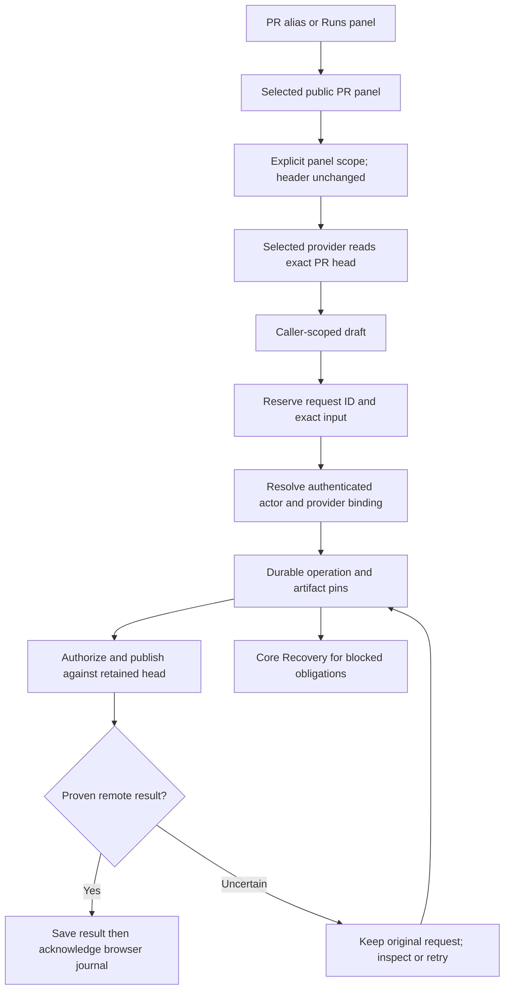

# Pull request plugins

The `/prs` and `/pr` aliases select `helmsman.compat-pr/page` in the `helmsman/pr-compatibility-page` slot. The contribution and composition identifiers retain their historical names so existing layouts survive. The implementation is now an independently buildable public SDK package, with no private PR session or legacy drawer.

The page accepts `helmsman/pull-request-panel@1` panels. Its initial `pull-request` instance uses `helmsman.compat-pr/panel`; saved layouts, including empty layouts and missing panels, remain authoritative. The panel uses public PR list, inspection and review-command services, plus run reads and commands. Review and rerun launches use the same public command journal as other run controls. Run selection opens the shared auxiliary viewer.

## Scope and routes

Header scope stays unchanged when a user selects another galleon inside a panel. The panel must call public `setScope` before accessing that explicit target. `PluginPageState.pullRequest` is a validated route hint containing `{version:1,repo,number,mode}`; mode is `review`, `rerun` or null. It coexists with the independent run `presentation` locator and works when an author renames the panel contribution. `PluginPanelState.headerRepo` separately exposes the header default, including null for All, so setup links preserve it while `repo` reflects effective panel scope. Neither hint grants service access by itself. Explicit namespaced panel route state takes precedence. The host preserves legacy PR panes, targets and setup modes.

Draft/result storage uses the host-provided `PluginPanelContext.contributionId`, and command journals use the same caller identity. Renamed copies receive separate storage and requests. Missing host identity prevents storage access. This does not migrate old memory-only private-session drafts across an application reload.

## Durable manual review

Declare `helmsman/pull-request-command@1` to use `context.services.pullRequestCommands`. Submit `{version:1,repo,number,expectedHeadSha,event,body}`. Events are `APPROVE`, `REQUEST_CHANGES` and `COMMENT`. The browser reserves the request ID before transport and retains the exact body and observed head. Changed intent cannot replace an unresolved request for that caller and PR.

The server prepares the authenticated actor and head read-only, then commits an operation with exact provider artifact, connection, credential handle, target and input. Only then may the provider publish. A complete receipt proves matching galleon, PR, head, authenticated actor and remote review ID. Configured author labels do not establish publication authority.

`receipt` checks the retained request. `retry` redelivers its original command and request ID; it also handles a first attempt that never reached the server. A missing browser record sends nothing. Pending or uncertain operations remain retained; blocked operations report `recovery-required` because Core Recovery may reopen them. Save a terminal result durably before `acknowledge`. Browser acknowledgment removes only the browser journal entry; server operation evidence remains.

## Replaceable provider

The independently buildable [GitHub package](../src/plugins/github/README.md) registers `helmsman/pull-request@1` with `registerPullRequest`. It owns list, detail/diff, review preparation, publication and reconciliation. The host owns scope, credentials, bounded HTTP, operation leases, authorization and retained artifacts. Credentials never enter frontend state or package settings. Read and reconciliation ports cannot POST; invocation rechecks authorization before each POST.

Select a provider with `plugins select-pull-request example.github/github`; `default` restores `helmsman.github/github`. Selection is persisted. An unavailable selected provider never silently falls back. New requests use the current selection; existing obligations resolve their exact retained provider. Disabling or replacing a provider does not migrate unresolved operations to another implementation.

Copy `plugin-sources/compat-pr` and `plugin-sources/github` from the distribution, install its SDK and TypeScript, build, pack, install and enable them. Rename the frontend manifest ID and its initial self-references; keep public slot and contract IDs. Use `plugins select helmsman/pr-compatibility-page example.pr/page` to select the copied frontend. See [package installation](plugin-packages.md).

Optional Slack review controls currently open a narrow Config surface using `slackPrRepo` and `slackPr`. That surface retains existing in-memory Slack request identities and performs no send on navigation. Slack extraction is the next delivery milestone; it is not a dependency of the public PR package.
