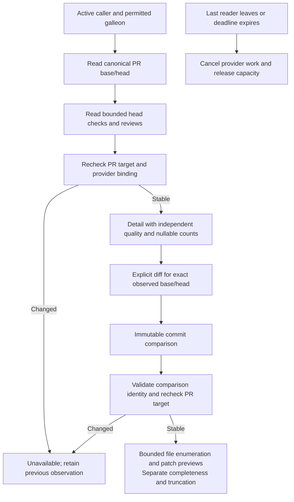

# Pull request inspection

Declare `helmsman/pull-request-inspect@1` and use optional `context.services.pullRequestInspect`. Import public types from `@helmsman/plugin-sdk`. This facet adds detail and bounded diff reads without changing `helmsman/pull-request-read@1` list behavior. It does not submit reviews, launch work or send Slack messages. The private PR compatibility panel remains separate until those action contracts and preservation gates are delivered.

```ts
const inspect = context.services?.pullRequestInspect;
if (!inspect) throw new Error('Pull request inspection is unavailable');
const detail = await inspect.detail({ version: 1, repo: 'owner/project', number: 7 }, signal);
if (detail.status === 'available') {
  const diff = await inspect.diff({ version: 1, target: detail.value.target }, signal);
}
```

The target contains canonical `repo`, positive `number`, `headSha` and `baseSha`. A diff request uses the exact observed target. A changed base or head returns `head-changed`; reread detail explicitly instead of silently inspecting a different revision. Browser scope follows the invoking page or panel, and an explicit panel override does not change the header. Core restricts reads to configured galleons and checks authority again after asynchronous reads. Hidden activity, scope changes, caller cancellation and disposal cancel scoped work. A caller leaving a shared read does not cancel another caller's interest; the last departure cancels provider work. Deadlines release capacity even if a provider ignores cancellation.

Responses are `available` with validated DTOs or `unavailable` with a bounded reason. Missing provider data, inaccessible targets, changed revisions, incomplete observations and empty results are distinct. No raw provider payload, token or private path enters the contract.

## Detail and observation quality

Detail contains the PR title/link, open/closed/merged status, draft flag, author, branch, comment count, base/head target and observation timestamps. Checks and reviews have their own `complete`, `partial` or `unavailable` quality. Their counts are null when enumeration is incomplete or unavailable; never render that as zero or a clean result. Checks include both check runs and classic commit-status contexts for the observed head. Reviews reduce submitted events to each reviewer's effective state only after complete enumeration.

`isOwnPr` and `viewerReview` refer to the configured GitHub author used by the existing presentation. They do not establish the authenticated credential actor or permission to submit a review. Review commands must independently verify current authority. The viewer timestamp and commit identify the latest submitted review by that configured author; a later comment does not erase an earlier decisive approval or change request.

Metadata is read before and after subordinate observations. Base/head changes reject the result. Changed review metadata can yield partial review quality. Statuses and reviews remain observed data, not an atomic snapshot of GitHub. A provider or credential configuration change during a read rejects the mixed observation.

## Diff previews and limits

Diff coverage is explicitly `immutable-comparison-preview`. The GitHub provider requests a fixed base-SHA/head-SHA comparison, verifies response identity, and checks that the PR still targets those revisions. It does not use a mutable PR-files read as proof of a frozen diff. The comparison's last returned commit is not evidence of the head: GitHub may paginate commits separately.

The public result contains at most 100 files. `quality: complete` means the file enumeration was proven complete within provider limits; it does not mean patch text is complete. Reaching the provider's 300-file cap, or returning fewer files than the comparison lists, produces partial enumeration and `truncated: true`. Each file separately labels its patch `preview`, `truncated` or `unavailable`; a missing patch is null. Binary files or omitted patches must not appear as empty textual changes.

Each patch is bounded to 32 Ki UTF-16 code units; cumulative patch text is bounded to 256 Ki code units. Public/provider JSON responses are bounded to 2 MiB each, aggregate provider transport to 12 MiB, and each review/check collection to three pages of 100. Requests have a 30-second deadline. There is no diff cursor or full-patch download in this version. See GitHub's [comparison endpoint](https://docs.github.com/en/rest/commits/commits#compare-two-commits) for its independent commit and file pagination limits.



## HTTP and acceptance

Host adapters use `GET /api/pull-request-inspect/detail?repo=owner%2Fproject&number=7` and `GET /api/pull-request-inspect/diff?repo=owner%2Fproject&number=7&headSha=…&baseSha=…`. Route validation rejects malformed or repeated fields. Application disconnect cancellation reaches provider reads. Safe-start and plugin lifetime rules remain unchanged.

The contract, browser adapter, provider and route tests cover scope, revisions, malformed/null data, response bounds, partial collection quality, configuration changes, shared cancellation and uncooperative providers. The [production scenario](../tests/distribution/pull-request-inspect-host.pw.ts) compiles an independent copied-SDK page in a source-denied installation and exercises the real provider/router/application against isolated GitHub fixtures. It verifies classic status failures, partial counts, missing/clipped patches, stale head rejection, foreign-scope denial, explicit cancellation, header-scope cancellation reaching the provider, and reload. Track verified completion and remaining PR action work in the [implementation ledger](plugin-implementation-progress.md).
