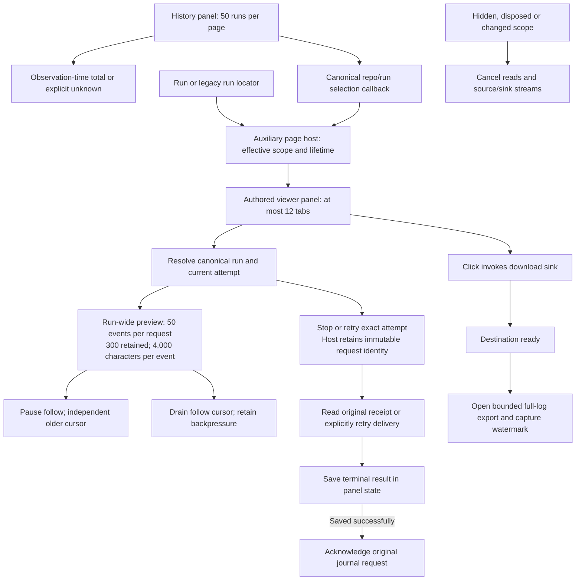

# Run viewer and history authoring

E4 introduces separate authored viewer and history packages. They remain implementation candidates while the existing run surfaces serve users. Public presentation locators and services are the package boundary; a copied package compiles against the distributed SDK using only type imports. Runtime imports stay inside the package.

| Package | Page slot and composition | Panel contract | Panel services |
| --- | --- | --- | --- |
| `helmsman.run-viewer` | `helmsman/run-viewer-page@1` | `helmsman/run-viewer-panel@1` | run-inspect, run-read, run-command, download |
| `helmsman.run-history` | `helmsman/run-history-page@1` | `helmsman/run-history-panel@1` | run-inspect |

The page entries use composition discovery, saved layout, mounting and activity. They preserve empty layouts and disabled/missing implementation identity. A replacement page may compose compatible panels differently; a replacement panel does not require replacing its page or the other package. The bundled `helmsman.*` IDs are reserved; third parties use their own IDs.

Before building a copied package, rename both `manifest.id` and its self-referencing initial-layout contribution IDs, for example `helmsman.run-viewer` to `example.run-viewer` and `helmsman.run-viewer/panel` to `example.run-viewer/panel`. Keep shared slot, composition and panel-contract identifiers unchanged. Follow the [descriptor rewrite, pack and install recipe](plugin-packages.md#opt-in-task-presentation-packages), then select or open the independently installed page. A descriptor retaining a reserved package ID is rejected by installation.

`PluginPageState.presentation` also reaches panels. The optional `context.selectPresentation(locatorOrNull)` callback returns synchronously and can reject invalid, inactive or out-of-scope selections. Its locator is a canonical `{ version: 1, kind: 'run', repo, runId }`, compatibility `{ version: 1, kind: 'legacy-run', runId }`, or `{ version: 1, kind: 'pull-request', repo, number }`. The host captures effective scope; packages cannot widen a concrete repository scope by emitting another repository. An explicit panel scope may select within that scope without changing the header. A legacy run ID must resolve within the current scope before becoming canonical.

The generic auxiliary host owns attachment and page lifetime. The viewer package owns tabs, selection, focus, scroll, bounded log windows, attempt revalidation and command receipts. Rehoming a visible instance retains that session. PR details, review actions and Slack coupling currently remain in the existing application drawer. A separately tracked legacy PR compatibility panel is required before viewer cutover; that bridge has not yet been extracted. Authored packages do not import private PR clients or renderers.

History retains a cursor stack rather than every page of runs. Counts share the insertion bound and filters but describe mutable state at observation time. Viewer log pagination keeps backward and follow cursors separate. Browsing earlier logs pauses following; releasing an end of the 300-event window is disclosed, and returning to that end rebases to a bounded latest window. Preview clipping never changes full export text.

Closing a viewer tab never clears its journal entries. Unknown receipts and recovery-required results remain visible independently of tabs. Reading a receipt is distinct from redelivery. Redelivery supplies the same saved input to the host journal, retaining its original request ID and attempt. Terminal results persist before acknowledgment; a failed save prevents acknowledgment. Saved result removal is an explicit local action, not reversal of a command.

Copy uses only the bounded preview. Full download follows [download authoring](download-authoring.md): open the export after destination readiness, retain scope/attempt fences, and distinguish disk-save confirmation from delivery to the browser. Cancellation cannot promise that every browser dismisses its native download UI.

Package state/lifecycle and composition tests cover these behaviors. Both packages compile against a copied distributed SDK under the source-denial loader, pack and install as independent replacements. The package browser gate recompiles those copied sources and verifies canonical selection, paused-window preservation, desktop/mobile rendering and absence of horizontal overflow. One full-shell source-denied production scenario also passes: history selection opens the auxiliary viewer, canonical `runRepo` survives reload independently of header scope, explicit selection reveals/focuses the viewer, hidden/resumed logs remain correct, passive shell polling preserves history pagination and paused standalone logs, disabled selected pages remain unavailable, and logs stay reachable on mobile. Converging standalone and auxiliary viewing onto one retained session, replacing legacy `/runs`, and extracting the PR compatibility boundary remain pending. Track completion in the [E4 implementation plan](plugin-phase-e4-implementation.md) and [implementation ledger](plugin-implementation-progress.md).

_Helmsman · not reported - not reported_
