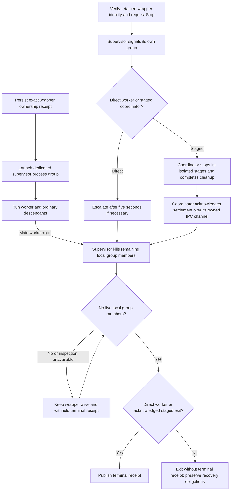

# Local execution hosts

This backend-only package registers `helmsman.host-local/detached`, `helmsman.host-local/cmux`, and `helmsman.host-local/wezterm` through `helmsman/execution-host@1`. Each provider retains the exact launch attempt, wrapper receipt, process identity, and native terminal reference. Missing or conflicting ownership evidence is reported as unknown and is never replaced by another provider.

The providers advertise `coordinatorProtocol: 1` and serialize the core `coordinator` flag. Hosts without that capability cannot admit new staged work; existing retained bindings keep their original metadata and ownership evidence.

The package settings `cmuxSocketPath`, `weztermBin`, and `weztermRunWorkspace` are captured with the retained provider binding. Build with `npm run build` after installing the released `@helmsman/plugin-sdk`, TypeScript and `@types/node`.

Local execution uses POSIX process groups on macOS and Linux. The wrapper starts a dedicated supervisor group for the worker and its ordinary descendants; cmux and WezTerm terminal groups are never signalled. Stop verifies the retained wrapper PID and process-start identity, then asks the supervisor to terminate its own group. Direct workers receive a five-second grace period before forced termination. Natural worker exit also cleans remaining background descendants. The wrapper publishes its terminal receipt only after the group contains no live processes; unreaped zombies cannot continue execution.

A crashed supervisor does not establish completion: the wrapper waits for any surviving group members before writing a failed outcome. A crashed wrapper disconnects the supervisor's ownership channel and triggers group cleanup, but cannot write a terminal receipt; recovery remains unknown until supported evidence is available. This containment covers ordinary inherited process groups, not deliberately daemonized descendants that escape into new sessions. Staged pre-PR coordinators retain their own separate stage-group cleanup; the outer supervisor does not race that cleanup with another escalation deadline. A staged coordinator must acknowledge successful cleanup over its owned IPC channel before a numeric exit can establish settlement. Signals, uncaught exceptions, explicit early exits and failed or incomplete stage cleanup produce no acknowledgement and no terminal receipt because isolated stages may still exist. A supervisor crash before forwarding that acknowledgement also leaves settlement unknown. A coordinator that stalls during cleanup retains its wrapper ownership and reservation.

Windows local launches fail before worker execution because this implementation has no Windows Job Object equivalent. Existing ownership receipts remain inspectable and verified Stop remains available. No PID or terminal-wide group is guessed when ownership is missing.
