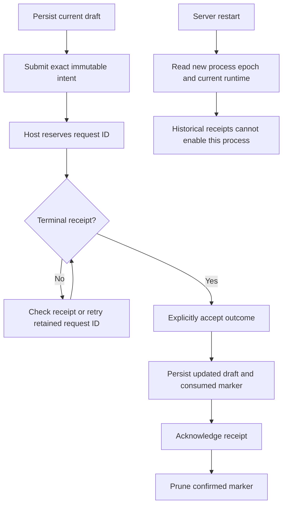

# Source settings

Builtin standalone TypeScript page and two replaceable panels built against public `@helmsman/plugin-sdk` declarations. Production SDK imports are type-only; runtime imports are package-relative. Source administration requires `helmsman/source-admin@1` and uses `context.services.sourceAdmin` exclusively.

## Build and install

Helmsman registers the checked-in `helmsman.source-settings` descriptor as a builtin. `/source-settings` resolves the selected implementation of `helmsman/source-settings-page`, with `helmsman.source-settings/page` as its default. Public `pack` and `install` reject that namespace. To install your own independent implementation, build a package as `example.source-settings` and rewrite its self-referencing initial panel contributions as shown below. Keep shared `helmsman/...` contract, composition and slot IDs unchanged.

Run in a copy of this author directory. Set the release location and the same plugin-store/database paths used by your Helmsman instance. Plugin-store paths must use real directories without symlink components:

```sh
HELMSMAN_RELEASE=/absolute/path/to/release
export HELMSMAN_PLUGINS_DIR=/absolute/path/to/operator-data/plugins
export HELMSMAN_DB=/absolute/path/to/operator-data/state.sqlite
npm install --no-save "$HELMSMAN_RELEASE/sdk" typescript
npm run build
node --input-type=module <<'JS'
import { readFile, writeFile } from 'node:fs/promises';
const path = 'dist/plugin-package.json';
const descriptor = JSON.parse(await readFile(path, 'utf8'));
const previousId = descriptor.manifest.id;
const pluginId = 'example.source-settings';
descriptor.manifest.id = pluginId;
for (const page of descriptor.manifest.pages ?? []) {
  for (const instance of page.composition?.initialLayout?.instances ?? []) {
    if (instance.contributionId?.startsWith(`${previousId}/`)) {
      instance.contributionId = `${pluginId}/${instance.contributionId.slice(previousId.length + 1)}`;
    }
  }
}
await writeFile(path, JSON.stringify(descriptor, null, 2) + '\n');
JS
node "$HELMSMAN_RELEASE/server/helmsman/plugins/cli.js" pack dist source-settings.hmp
node "$HELMSMAN_RELEASE/server/helmsman/plugins/cli.js" install source-settings.hmp
node "$HELMSMAN_RELEASE/server/helmsman/plugins/cli.js" enable example.source-settings
```

Use a new archive filename or remove your previous generated archive before rerunning `pack`; it does not overwrite archives. Restart Helmsman with those same store/database paths and reload the browser after installation changes.

Open `/plugins/example.source-settings/page?repo=owner/project`, or omit `repo` for All. The contribution IDs below describe this renamed installation. The builtin is available at `/source-settings` and `/plugins/helmsman.source-settings/page`, with a link from Config. Choose this external page for the alias with `select helmsman/source-settings-page example.source-settings/page`; `select helmsman/source-settings-page default` restores the builtin selection. Disabling the selected implementation keeps its selection and state and shows an unavailable page. The reserved builtin ID and external installed ID have independent enablement.

## Contributions and layouts

| Contribution in the independent package | Role |
| --- | --- |
| `example.source-settings/page` | Owns `helmsman/source-settings-page`; requires `helmsman/composition@1` |
| `example.source-settings/panel` | Implements `helmsman/source-settings-panel@1` for configuration, replacement and automatic starts |
| `example.source-settings/automatic` | Implements `helmsman/todos-panel@1` for source selection, current-process enablement and related requests |

The builtin uses the corresponding `helmsman.source-settings/*` IDs. A fresh Source settings composition seeds one administration panel. Fresh builtin [Todos](../todos-ui/README.md) layouts include `helmsman.source-settings/automatic`; existing and intentionally empty layouts remain authoritative. Choose the desired **Automatic starts** implementation and **Add panel** to add one explicitly. An external `example.source-settings/automatic` can coexist with the builtin implementation. Disabling an implementation leaves its unavailable panel placeholder and saved state.

Exact `panel=<instance>` links reveal an existing hidden/collapsed administration panel; missing targets never create a default instance. If revealing a panel cannot be saved, the page reports the failure and its toolbar **Refresh** explicitly retries; background refresh does not repeat the layout mutation.

## Configuration, scope and drafts

`sourceAdmin.snapshot()` exposes source identities/revisions, declared setting schemas, explicitly stored values, compatible installed replacement candidates, per-galleon schedules and current-process runtimes. Credentials and undeclared internal settings remain private to the host/provider.

Configuration is source-wide across all allowed galleons. `changes.settings` is the complete map of explicitly stored declared settings: omitting a declared key resets it to the provider default, while undeclared internal settings remain untouched. Defaults are displayed as hints rather than materialized into writes. When a provider is unavailable and no schema is exposed, an empty settings map preserves all stored settings while core configuration remains editable. List/map fields use JSON so embedded newlines remain lossless.

Drafts are versioned and bounded to 512 KiB. Unsupported versions block overwriting. Configuration drafts pin their source revision; explicit reconciliation updates untouched fields while keeping edits. A field removed from the current schema stays visible as a retained draft value until explicitly discarded. Replacement drafts retain actor, reason and candidate across instance-revision changes and require explicit reconciliation before validation.

Choose a galleon through the public panel scope control before changing its automatic selection, current-process runtime or replacement. All scope permits source-wide configuration and viewing all visible requests. Each panel instance has its own scope and draft state; changing the header does not retarget an already recorded request.

## Automatic starts and replacement

Saved source selection and runtime enablement are separate commands. Selection persists across server restarts; runtime enablement applies only to the current process epoch and uses revision checks. Selected retired or unavailable sources remain visible so an operator can remove them.

Replacement candidates come from the snapshot's exact provider ID, artifact hash and mode. `validateReplacement()` returns pinned evidence; actor, reason, candidate, target or scope changes invalidate it. Applying that evidence uses `submit({kind:'replace', ...})`; stale proofs are rejected by the host. Source configuration, schedules and runtime mutations also use `submit()` with explicit expected revisions.

## Durable outcomes



`pending()` is the authoritative host journal. `receipt()` checks the original request and scope; `acknowledge()` is called only after the terminal transition is persisted. Unknown outcomes retain their immutable input and request identity for explicit retry. Matching unresolved or unacknowledged requests block new configure/schedule/runtime/replacement intents. Confirmed acknowledgments remove consumed markers, preventing receipt history from exhausting draft bounds.

A runtime `expired` receipt means the previous process ended with an unknown outcome; it does not mean the command was unapplied. Historical successful receipts are also distinct from current runtime state. Neither receipt automatically reenables the new process. Configuration receipt lookup remains available for its original scope even after a successful edit removes the source's last allowed galleon.

## Verification and rollout

Thirteen focused tests cover schema defaults/JSON validation, revision merging, uncertain retries, save-before-acknowledge, runtime history, pinned replacement evidence, retained revision drafts, focus/caret, bounded history, unavailable selections, removed schemas and unsupported versions.

[The isolated distribution gate](../../../tests/distribution/source-settings-host.pw.ts) installs the package under `example.source-settings`, builds only against the released SDK, and denies application-source imports. It covers configuration response loss after removing the last allowed galleon, persistent scheduling plus runtime restart, and stale pinned replacement rejection. Its inspected visual snapshot masks the generated source instance identity.

The builtin alias and Config link replace the legacy source-settings presentation. Historical APIs remain available for existing clients and recovery. Current cutover validation and remaining rollout work are tracked in [implementation progress](../../../docs/plugin-implementation-progress.md).

Delivery retry requires the host's optional `retry({ repo, requestId }, signal)` operation. It reads only the original caller-owned retained request and never reserves another identity. Missing requests remain unavailable; older hosts disable retry while keeping receipt checks available. New intentional submissions use `submit` separately.

## Interface guidance

The Task sources page separates source-wide settings, saved automatic source selection and automatic starts for the current server session. Field and action help explains scope, persistence and effects on existing work. Buttons fit their labels and wrap in action groups; inputs retain the available form width. Source IDs, request IDs and connector hashes remain in native detail disclosures. Replacement controls start collapsed and stay open through edits and redraws. Provider-format hints are associated with their fields, and default reset controls update immediately after edits.
