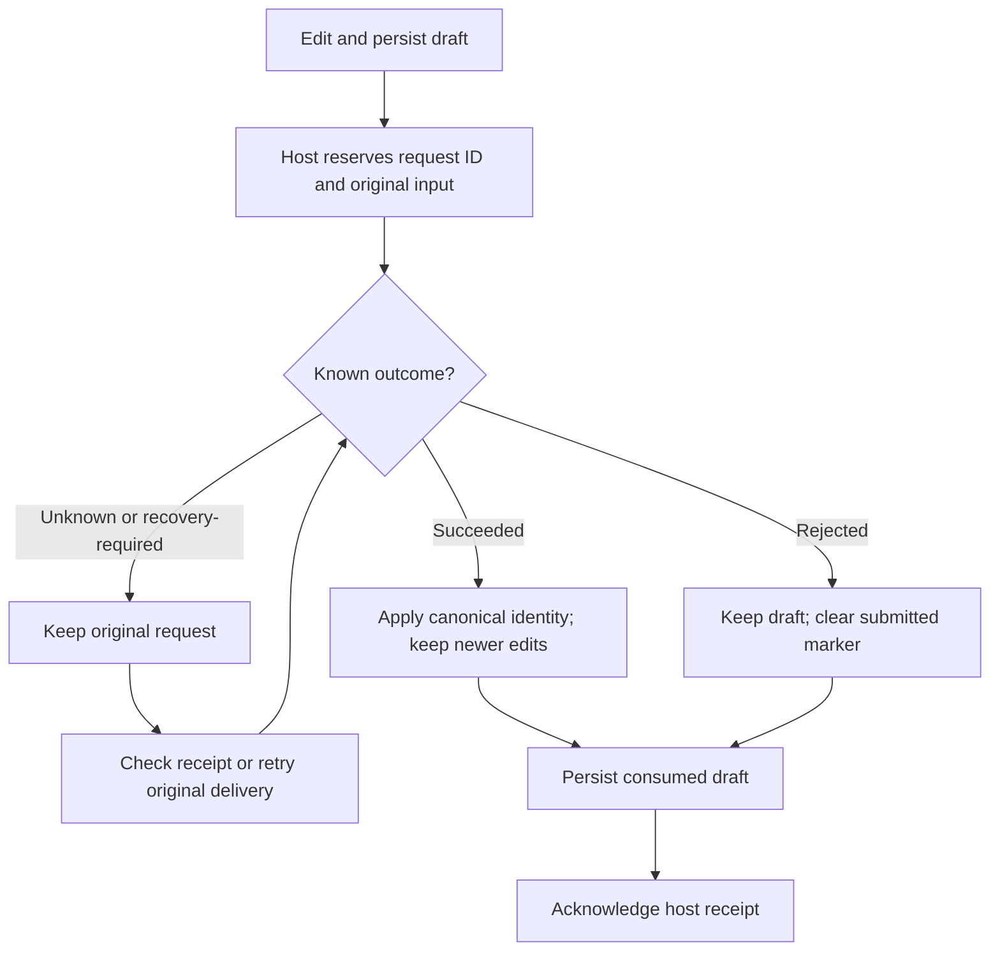

# Todos presentation package

Opt-in composition page and editor panel for sources implementing `helmsman/local-task-editor@1`. Source identity and create/update/delete command names come from public editor discovery; no provider ID or private application import is required. Production code uses SDK type imports and package-relative runtime imports.

## Build and install

The checked-in descriptor uses the reserved `helmsman.*` namespace for a future builtin rollout. Public `pack` and `install` reject that namespace. For the current opt-in installation, build an independent package as `example.todos-view` and rewrite its self-referencing initial panel contributions as shown below. Keep shared `helmsman/...` contract, composition and slot IDs unchanged.

Run in a copy of this author directory. Set the release location and the same plugin-store/database paths used by your Helmsman instance. Plugin-store paths must use real directories without symlink components:

```sh
HELMSMAN_RELEASE=/absolute/path/to/release
export HELMSMAN_PLUGINS_DIR=/absolute/path/to/operator-data/plugins
export HELMSMAN_DB=/absolute/path/to/operator-data/state.sqlite
npm install --no-save "$HELMSMAN_RELEASE/sdk" typescript
npm run build
node --input-type=module <<'JS'
import { readFile, writeFile } from 'node:fs/promises';
const path = 'dist/plugin-package.json';
const descriptor = JSON.parse(await readFile(path, 'utf8'));
const previousId = descriptor.manifest.id;
const pluginId = 'example.todos-view';
descriptor.manifest.id = pluginId;
for (const page of descriptor.manifest.pages ?? []) {
  for (const instance of page.composition?.initialLayout?.instances ?? []) {
    if (instance.contributionId?.startsWith(`${previousId}/`)) {
      instance.contributionId = `${pluginId}/${instance.contributionId.slice(previousId.length + 1)}`;
    }
  }
}
await writeFile(path, JSON.stringify(descriptor, null, 2) + '\n');
JS
node "$HELMSMAN_RELEASE/server/helmsman/plugins/cli.js" pack dist todos-ui.hmp
node "$HELMSMAN_RELEASE/server/helmsman/plugins/cli.js" install todos-ui.hmp
node "$HELMSMAN_RELEASE/server/helmsman/plugins/cli.js" enable example.todos-view
```

Use a new archive filename or remove your previous generated archive before rerunning `pack`; it does not overwrite archives. Restart Helmsman with those same store/database paths and reload the browser after installation changes.

Open `/plugins/example.todos-view/page?repo=owner/project`, or omit `repo` for All. The contribution IDs below describe this renamed installation. `/todos` still serves the legacy page; declaring the future `helmsman/todos-page` slot does not replace that alias. `helmsman.todos-ui` is not registered as a builtin yet, so enabling that reserved ID does not install this package.

## Contributions and public services

| Contribution | Contract or service |
| --- | --- |
| `example.todos-view/page` | `helmsman/composition@1`; owns `helmsman/todos-page` |
| `example.todos-view/panel` | `helmsman/todos-panel@1` |
| Editor discovery and record reads | `context.services.taskEdit`, `helmsman/task-edit@1` |
| Durable create, update and delete | `context.services.sourceCommands`, `helmsman/source-command@1` |
| Source-qualified run launch | `context.services.runCommands`, `helmsman/run-command@1` |
| Historical Todo request recovery | `context.services.todoLegacyRecovery`, `helmsman/todo-legacy-recovery@1` |

The manifest seeds one editor panel only when a composition has no saved layout. Intentionally empty layouts remain empty. Add, hide and reopen compatible panel implementations through the page toolbar; hiding does not delete drafts. Install and enable [source-settings](../source-settings/README.md), then choose **Automatic starts** and **Add panel** to add `example.source-settings/automatic`. That optional panel is discoverable through the same `helmsman/todos-panel@1` contract and is not silently inserted into existing layouts.

## Scope, drafts and recovery

All-source reads retain independent cursors, actual creation timestamps, filtered totals and unavailable-source coverage. Provider search matches identity, title, description, acceptance criteria and galleon before pagination. Batches read up to eight sources with four concurrent requests, retaining at most 1,000 rows before requiring narrower filters. Loaded rows sort by priority, then oldest creation time; unknown timestamps and incomplete counts stay explicit.

Creation requires an explicit or unique compatible source. A new unspecified destination follows the header; an explicitly selected destination changes panel scope through `context.setScope`. Existing drafts stay pinned to their origin when the header changes. A move submits both origin identity and explicit destination, then consumes the canonical returned identity before offering a scope change.

Versioned drafts preserve unsent text, source and record revisions, caret, and immutable submitted input. Stale records require explicit reconciliation; unchanged fields update from the server while dirty fields remain. Unsupported state versions block overwriting. Draft state is bounded to 512 KiB. Claimed records cannot be edited, deleted or launched. Deletion and draft discard require explicit confirmation. A run requires a saved, unchanged Todo with a persisted description, followed by a fresh source-qualified envelope check.



Uncertain source commands and launches keep their original identity. Check and retry actions never create a replacement intent. Recovery links retain the request's original galleon. Terminal result consumption persists the updated draft before acknowledgment; a failed save retains the receipt.

Older Todo requests use the host compatibility journal. Inspecting nonempty legacy state requires explicit All panel scope. The panel checks original request IDs and dismisses confirmed terminal outcomes only after saving drafts; unresolved mutations cannot be reissued with a new identity.

## Verification and rollout

Unit tests cover composition lifetime/layout persistence, editor scope and drafts, stale reconciliation, response recovery, moves, claims, launches and legacy requests. [The isolated production gate](../../../tests/distribution/todos-ui-host.pw.ts) installs the package as `example.todos-view`, builds against the released SDK with source access denied, and covers four scenarios: durable create response loss/reload/update, move/delete, legacy recovery, and All-source search/persisted launch readiness. The gate includes an inspected editor screenshot.

Todos and Automatic starts are independently buildable and verified at canonical routes. Default installation, alias cutover and removal of legacy presentation remain separate rollout work tracked in [implementation progress](../../../docs/plugin-implementation-progress.md).
